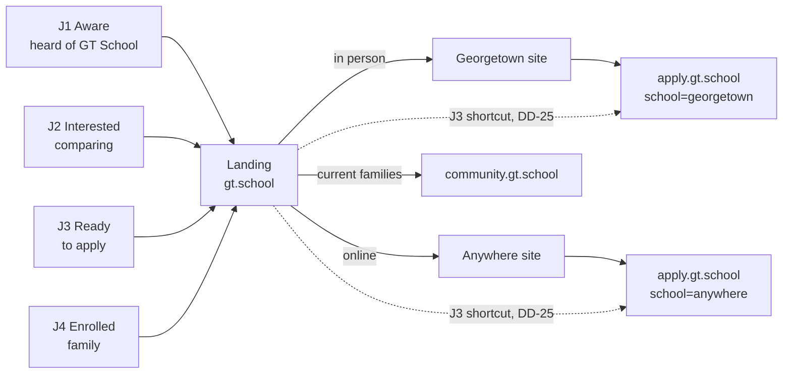

# 00 Context: what GT School is and what this project is for

| Field | Value |
|---|---|
| Read this | First, every session. Then `README.md` for the index, `09-operating-model.md` for how we work, `ID-INDEX.md` for every id |
| Sources | Verified: the mirrored Anywhere pages in this repo; the GA4 property via `tools/ga4-snapshot.py` (see `10-analytics-current-state.md`); the v1 checkout's `docs/ANALYTICS.md` (verified 2026-08-28). Flagged as prior knowledge: the Alpha School network (`08` section 2). The call: `01` |
| Version | 0.1, 2026-09-10 |

## The one-paragraph version

GT School is the selective school for gifted students inside the Alpha School network; the Anywhere homepage calls itself "The Gifted Academy of Alpha School". It has two forms: the Georgetown, Texas campus (in person) and GT Anywhere (virtual, K-8, quarterly in-person intensives). Academics run on the TimeBack platform for about two hours a day, MAP-aligned, with afternoons for projects. Admission is for students at the 90th percentile and above. Anywhere tuition is $10,400 a year and the Texas TEFA voucher covers it in full for eligible families; Georgetown tuition is not known here (Q-011). The positioning is "the MIT of K-8": rigor proven by outcomes. This project builds one umbrella landing page that routes a parent to the right school, then aligns the two school sites and gives their content an owner.

## The web estate today

| Surface | URL | What it is | Platform | Analytics tags | Sessions, 28 days to 2026-09-10 |
|---|---|---|---|---|---|
| Georgetown campus site | gt.school | The in-person school's site; carries the "GT School" brand | Webflow (Nari) | **None. The site is untagged** (AN-01, REQ-027) | Unknown, because untagged |
| GT Anywhere site | anywhere.gt.school | The virtual school's site; mirrored in this repo | Webflow (live); static mirror here | GA4, Meta pixel, TikTok pixel, HubSpot | 6,302 |
| Application | apply.gt.school | Interest, Apply, Enroll, Tuition; also `#/dashboard` and `#/community-map` | React and Supabase, separate repo `apply-gt-school` | GA4, Google Ads tag, X pixel | 686 |
| Community hub | community.gt.school | Current families (Q-002 to confirm) | Unknown | GA4 | 366 |
| Summer | summer.gt.school | Summer program | Unknown | GA4 | 182 |
| Intensives app | gt-intensives.vercel.app | Intensives tooling | Vercel | GA4 | 169 |
| Umbrella landing (planned) | gt.school root (D-001) | The front door this project builds | Static on Vercel (D-002) | Via a GTM container (AN-03) | 0 |

## Two forms of one school

| | Georgetown campus | GT Anywhere |
|---|---|---|
| Format | In person | Virtual, K-8, with quarterly in-person intensives |
| Where | Georgetown, Texas | Anywhere; intensives location per Q-017 |
| Site | gt.school (Webflow) | anywhere.gt.school (Webflow; mirrored here) |
| Tuition | Unknown here (Q-011) | $10,400 a year; the $10,474 TEFA voucher covers it for eligible Texas families |
| Admission | Selective; criteria per Q-012 | Students at the 90th percentile and above |
| Adults | Advisors (Alpha says guides) | Advisors |
| Platform | TimeBack, MAP-aligned, about two hours of academics a day | Same |
| Afternoons | Projects and workshops | Projects; an Accelerated Foundations track for the youngest |

## Five facts every session must carry

| # | Fact | Consequence | Where it is decided |
|---|---|---|---|
| 1 | The Alpha affiliation is already public on the Anywhere homepage | Decide prominence, never disclosure | MD-17 |
| 2 | Anywhere is TEFA-covered for Texas families | Exclusivity is selectivity (90th percentile), never price | MD-25, DD-10 |
| 3 | The homepage carries three speed claims (3x, 4x, 3-7x), reads a 1400+ SAT target as a result, and states accreditation three ways (fully accredited, Candidate for Accreditation, and unqualified Accredited in structured data and in gt.school's footer) | No number or status claim on any new surface without an Approved claims-register row; no Cognia mark until the status is settled | MD-16, REQ-022, DEL-018, Q-033 |
| 4 | The site says "expanding nationwide" | Every choice component works with several campuses plus one virtual school | DD-21 |
| 5 | Traffic today is organic Instagram, search, direct, HubSpot email and alpha.school referrals; paid social is 32 sessions in 28 days; devices are mostly mobile | Design for the phone and for organic continuity first; paid message match is a later lever | DD-14, MD-23, AD-01 |

## Vocabulary

| Term | Meaning here |
|---|---|
| GT | Gifted and talented. Decode it on first contact (DD-33) |
| Georgetown campus | The in-person school in Georgetown, Texas |
| GT Anywhere | The virtual school |
| Alpha School | The parent network: the "2 Hour Learning" model, guides, workshops |
| TimeBack | The adaptive learning platform the academics run on |
| Advisors | GT's word for the adults (Alpha says guides) |
| Intensives | Anywhere's quarterly in-person weekends |
| MAP | The standardized growth assessment the outcome claims cite |
| TEFA | Texas Education Freedom Accounts, the state voucher that covers Anywhere tuition |
| Doors | The two school choices on the landing page |
| The register | `07-design-decisions.md`: every design, marketing, motion, analytics, advertising and chatbot decision with Fable and Astra columns |
| Fable, Astra | Claude Fable 5.1 (authors) and Codex Astra, `gpt-6-astra` (reviews) |

## Visitor journeys

| Journey | Visitor | Needs | Destination | Success signal | Priority |
|---|---|---|---|---|---|
| J1 | Heard of GT School, knows nothing | What it is, that there are two ways to attend, which is theirs | Landing, then the right school site | Door click-through; low bounce | 3 |
| J2 | Interested, comparing | Substance: academics, advisors, day, price, steps, FAQ | School site, FAQ, a tour or info session (REQ-044) | Pages per session; FAQ use; bookings | 2 |
| J3 | Ready to apply | The correct application, fast | apply.gt.school for the right school | Application starts per school; wrong-school rate near zero | 1 |
| J4 | Already enrolled | Community, schedules, support | community.gt.school (Q-002) | Fewer calls to the general line | 4, cheap |

## Positioning and hooks

| Element | Content | Status |
|---|---|---|
| Umbrella promise | The selective school for gifted children, in person in Georgetown or online from anywhere | Draft; the positioning brief (DEL-017) fixes it |
| Proof standard | Rigor proven by outcomes, every figure footnoted | Principle 2 in `08` section 3 |
| Hooks already in site language | "Education at the speed of aptitude"; "finally find peers who think like them"; "top 1-2% nationally"; "afternoons for the projects that make gifted kids come alive" | Tested per MD-03, MD-21 |
| Register | Institutional and warm; plain words first, GT terms second | DD-16, DD-30 |

## Known content debt

| Debt | Where | Owner | Tracked |
|---|---|---|---|
| Three speed multipliers and a target read as a result | Anywhere homepage | Nari | Q-019, REQ-022, DEL-018 |
| Georgetown site untagged | gt.school | Johnny | REQ-027, AN-01 |
| `page_view` configured as a GA4 key event, inflating conversions | GA4 property | Johnny | AN-05 |
| No tour, info session or open house CTA on any page | Both sites | Nari | REQ-044 |
| What follows 8th grade mentioned once | Anywhere academics | Nari | Q-013, REQ-048 |
| Mirror behind live; Phase 0 fixes on unmerged branches | This repo | Johnny | D-009, DEL-016 |
| gt.school header CTA `/book-a-tour` returns 404 on every page | gt.school | Nari | REQ-002 |
| Unedited Webflow placeholder text on gt.school `/` and `/academics` | gt.school | Nari | REQ-003 |
| Accreditation stated three contradictory ways across the two sites | Both | Nari, counsel | REQ-004, Q-033 |
| The same staff appear as "Guide" on gt.school and "Advisor" on Anywhere | Both | Nari | DD-27, Q-020 |

## Where each kind of question is answered

| Question | Document |
|---|---|
| What was said on the call | `01-call-summary-website-redo.md` |
| What must be built, and what counts as done | `02-requirements-and-deliverables.md` |
| What has been decided, what is open, what was pushed back on | `03-decisions-and-open-questions.md` |
| What exists and what is proposed, technically | `04-architecture.md` |
| How the five mocks get made and reviewed | `05-landing-mockups-plan.md` |
| Why each mock looks the way it does | `06-mockup-rationale.md` (planned) |
| Every design, marketing, motion, analytics, advertising and chatbot decision, with both models' reasoning | `07-design-decisions.md` |
| What optimal and effective mean; what else to consider | `08-effectiveness-and-expanded-considerations.md` |
| Which tool is for what, how work flows, environments, cadence | `09-operating-model.md` |
| What the analytics say today | `10-analytics-current-state.md` |
| How search and answer engines are handled through the redesign | `11-seo-aeo-plan.md` |
| Every id, where it is defined and referenced | `ID-INDEX.md` (generated by `tools/build-index.py`) |
