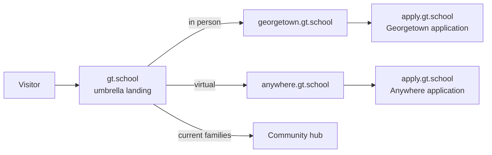

# Architecture: current and target web estate

Current state is verified from this repository and the live page markup. Target state is
proposed and depends on decisions D-001 to D-005.

## Current state

| Surface | URL | Platform | Controlled where | Notes |
|---|---|---|---|---|
| Georgetown campus site | gt.school | Webflow | gt.school Webflow project (Nari) | Carries the "GT School" brand; effectively the umbrella today (P-02) |
| GT Anywhere, live | anywhere.gt.school | Webflow | Webflow project, edited live | Last published by Webflow on 2026-07-09 per page markup |
| GT Anywhere mirror, v1 | Staging only | Static HTML, no build | This repo, `main` (v1) and `v2`; Vercel project `gt-website-v2` deploys `v2` | Faithful capture of 2026-07-24; behind live (D-009) |
| GT Anywhere v2 | None yet | Static HTML | This repo, `v2` worktree | Redesign; no deploy link by design (V2.md) |
| Application flow | apply.gt.school | Separate single-page app | Not in this repo | Receives "Begin Application" hand-offs from both sites; also hosts `#/dashboard` and `#/community-map` |
| Lead capture | Supabase edge function `partner-lead-webhook` | Serverless | Not in this repo | Called by the Begin Application modal on every Anywhere page; live even from localhost |
| Analytics and marketing tags | GA4 `G-494D3VN0SF` (gtag snippet, no GTM container), Meta pixel, TikTok pixel, HubSpot on Anywhere; Google Ads tag and X pixel on apply | Third party | Tag ids in every page head | One property (516065070, gtschool account) for every hostname except gt.school, which is untagged. Details and gaps in `10-analytics-current-state.md` |
| Community hub for enrolled families | community.gt.school (likely; Q-002 confirms) | Unknown | | 366 sessions in 28 days; sends referrals to Anywhere |
| Summer program site | summer.gt.school | Unknown | | 182 sessions in 28 days |
| Intensives app | gt-intensives.vercel.app | Vercel | | 169 sessions in 28 days |
| Chatbot platform (future) | none | TrueFoundry, per D-017 | | Readiness only (DEL-023); launch gated by D-006 |
| Cross-links between the schools | One-way | | | gt.school links to anywhere.gt.school on every page; the eight mirrored Anywhere pages never link back (R4) |

## Anywhere site structure today

| Path | Title | Placement |
|---|---|---|
| / | GT Anywhere: Elite Gifted Education at Home | Logo |
| /advisors | Our Academic Advisors | Nav |
| /academics | Academics | Nav |
| /intensives | GT Anywhere Intensives (quarterly in-person weekends) | Nav |
| /academic-calendar | 2026–2027 Academic Calendar | Nav |
| /privacy-policy, /terms-of-use, /refund-policy | Legal | Footer |
| Begin Application (modal) | Lead form, webhook, then apply.gt.school | Nav and hero CTA |

The Georgetown site's structure is not yet audited (DEL-002).

## Target state (proposed)

| Surface | Target URL | Platform | Repo location | Decision |
|---|---|---|---|---|
| Umbrella landing | gt.school | Static HTML on Vercel | `sites/landing/` | D-001, D-002, D-003 |
| Georgetown | georgetown.gt.school | Webflow restyled to the shared shell; static later if needed | Webflow in Phase 2; `sites/georgetown/` if rebuilt | D-001, D-005 |
| GT Anywhere | anywhere.gt.school | Static HTML on Vercel (v2) | `sites/anywhere/` | V2.md cutover |
| Design system | n/a | Tokens CSS plus header and footer partials, copied into each site at deploy | `design-system/` | D-003 |
| Application flow | apply.gt.school | Unchanged | External | |
| Analytics | Same GA4 property plus CTA and hand-off events | | Tag snippet lives in the design-system shell | D-010 |

## Design system layer

| Element | Source of truth today | Target |
|---|---|---|
| Typefaces | Literata and Inter Tight (local TTFs in the Anywhere mirror); Inconsolata via Google Fonts | Same faces, one `@font-face` set served from the design system |
| Colors, spacing, radii, shadows | Webflow-generated CSS: one shared file plus one per page | Extracted computed values in one tokens file (DEL-004); nothing invented |
| Header, footer, CTA buttons, modal | Duplicated verbatim in every HTML file | One partial each, copied into every page at deploy; edits happen once |
| Unifying brand element | Holly's draft (Q-001) | Applied identically on all three surfaces |

## Hosting and release

| Concern | Today | Target |
|---|---|---|
| Build step | None; files served as-is | None for content; a copy step for shared partials and tokens if D-003 (a) |
| Hosting | Webflow (live); Vercel (mirror staging) | Vercel for landing and Anywhere; Webflow for Georgetown until D-005 |
| Redirects | None needed | `vercel.json` redirect map for any moved URL (REQ-071) |
| Release path | v2, cutover PR, main, production (V2.md) | Same for every surface; landing go-live also needs DEL-009 sign-off |
| Verification | Playwright harness on branch `verify-anywhere-skill` | Extend the feature map to the landing page and to per-school application routing (REQ-070) |

## Unknowns that block the target

| Unknown | Blocks | Tracked |
|---|---|---|
| Georgetown page inventory and Webflow admin rights | IA proposal, D-001 | DEL-002, Q-006 |
| Community-hub destination | J4 routing | Q-002 |
| GA4 access and per-hostname coverage | KPI baseline | Q-003 |
| Whether Georgetown can move to a subdomain without losing rankings | D-001 | DEL-009 |
| Content owner and volume of change | D-004 | DEL-011 |
