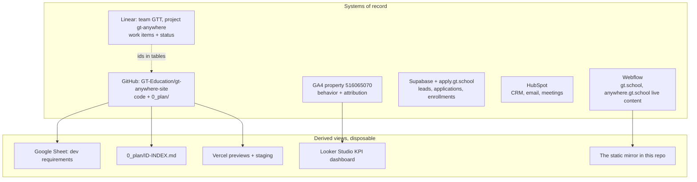
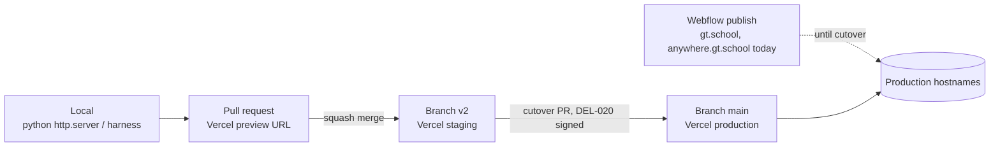
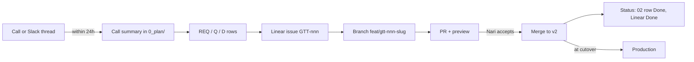
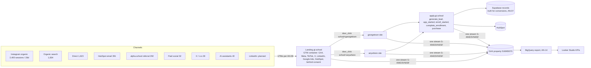
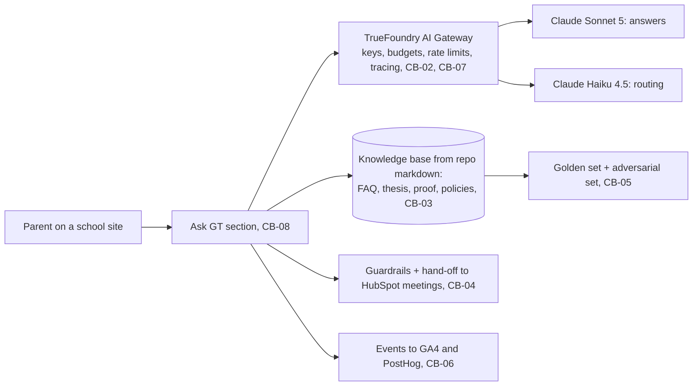

# 09 Operating model: tools, systems of record, flows, environments, cadence

| Field | Value |
|---|---|
| Purpose | How this project runs across GitHub, Linear, Webflow, Vercel, Supabase, HubSpot, GA4, the ad platforms, TrueFoundry and this planning folder. One system of record per data type; everything else is a derived view |
| Decisions this document rests on | D-013 (requirements source of truth), D-014 (analytics platform), D-015 (geolocation), D-016 (lead backend), D-017 (chatbot platform), D-018 (where status lives), D-019 (branches and PRs), D-020 (environments), D-021 (Webflow edits), D-022 (communication and cadence), D-023 (definition of done), D-024 (tools not used), D-025 (secrets and access), D-026 (analytics decision authority). All in `03`, each with Fable and Astra columns |
| Version | 0.1, 2026-09-10 |

## 0. The standard process

Ensemble planning and dual verification is the standard for every artifact in this project, decided by Johnny on 2026-09-10 (D-012 extended). Fable drafts, Astra reviews independently, each verifies the other, a checker confirms completeness and reasoning, and a gate opens only on a clean check. Decisions run through `12-register-loop.md`; tasks run through `1_spec/10-build-and-operations-spec.md` sections 3 and 9. No section of any document and no task is considered done on one model's word.

## 1. One system of record per data type

The canonical mapping is `SOURCES.md`: every source, what it is the truth for, its owner, how to verify against it and which source wins. Humans designate sources as truth in `TRUTH.md`. This section summarizes that mapping for the operating model; when they differ, `SOURCES.md` wins.

| Data type | System of record | Derived views | Owner | Rule |
|---|---|---|---|---|
| Requirements, decisions, architecture, plans | `0_plan/` in GitHub | The "dev requirements" Google Sheet, regenerated; Linear project description | Johnny writes, Nari approves | D-013. Never edit the sheet by hand |
| Work items and their status | Linear, team GT School (GTT), project gt-anywhere | The gate and ensemble columns in `05` section 8, which carry the Linear id | Johnny | D-018. One status home |
| Code and mocks | GitHub `GT-Education/gt-anywhere-site` (this repo); `apply-gt-school` for the application | Vercel previews | Johnny | D-019 |
| Live site content | Webflow for gt.school and anywhere.gt.school today; Vercel for the landing and Anywhere v2 after cutover | The mirror in this repo is a snapshot, re-taken by `tools/mirror.mjs` | Nari owns Webflow; Johnny owns Vercel | D-020, D-021 |
| Leads, applications, enrollments | Supabase behind apply.gt.school; the `partner-lead-webhook` | HubSpot views | Crystal operates; Nari owns | D-016 for future forms |
| CRM, email, meetings | HubSpot portal 40051392 | | Nari, Crystal | Q-023 confirms the lead sync |
| Behavior and attribution | GA4 `GT Web — All Sites` (516065070, account gtschool 403360775) | Looker Studio dashboard; `10-analytics-current-state.md` snapshots; PostHog if D-014 | Johnny; Nari reads | D-026 |
| Ad accounts | Meta, TikTok, X, Google Ads (two accounts linked), LinkedIn when opened | Weekly spend table | Operator per Q-025; David approves spend | AD-14 |
| Brand assets | Holly's source (to confirm: Figma, Canva or Drive) | `design-system/` and `0_plan/inputs/` | Holly | Q-001 |
| Conversations and decisions in flight | Slack | A dated call summary in `0_plan/` within a day | Everyone | D-022 |
| Session hand-offs between Cursor and Claude | `SESSION-HANDOFF-*.md` at the repo root | | Johnny | Global convention |
| Chatbot platform (future) | TrueFoundry workspace | | Johnny; David for billing | D-017, DEL-023 |
| Source-of-truth attestations | `0_plan/TRUTH.md`, edited only by humans in commits without an AI co-author, signed with an agent-inaccessible key once D-027 lands, and reviewed by a second human on GitHub | `0_plan/truth-proposals.md` (agents propose); `[SoT:TR-nnn]` tags in documents | Johnny, Nari | `truth.py check` fails on drift, fabricated tags, or a manifest changed outside a human commit |

## 2. What each tool is for, and not for

### 1b. Truth tiers

| Tier | Tag | Who sets it | What it means | Checked by |
|---|---|---|---|---|
| Source of truth | `[SoT:TR-nnn]` | A human, by moving a proposal into `TRUTH.md` in a human commit | The statement is true as written and frozen; changing it anywhere is drift | `0_plan/tools/truth.py check` |
| Verified | Dated "verified" note, for example the GA4 snapshot | A tool run against a system of record | True at the date shown; re-verify by re-running | The tool's own output filed in the document |
| Model-authored | No tag | Fable, Astra, builders | Reasoned, reviewed and audited, but not attested | The register loop and the audits |

Agents never type a `[SoT]` tag. They run `truth.py propose` with a verbatim statement, and the tag becomes valid only when a human attests. A typed tag with no attested row fails the check, which is what makes the tag worth trusting.

| Tool | Use it for | Do not use it for | Access today |
|---|---|---|---|
| GitHub | Code, planning documents, pull requests, review history, the id index | Task status, chat | Remote `git@github.com:GT-Education/gt-anywhere-site.git`; push over HTTPS as `gt-johnnychung` (memory: the SSH key lacks access) |
| Linear | Every work item, bug and its status; cycles; weekly project updates | Requirement text (link the REQ), decisions (link the D) | Team GTT, project gt-anywhere; `gta-NNN` maps to GTT ids (confirm, Q-026) |
| Webflow | Production for the two live sites; Georgetown restyle in Phase 2 (D-005) | The landing or Anywhere v2; any edit without a Linear issue and Nari's go | Nari owner; Johnny editor through the MCP from the v1 checkout only; the v2 worktree has none by design |
| Vercel | Previews per PR, staging for `v2`, production for the landing and Anywhere v2 | Team project `gt-website-v2` (team GT School, `prj_c3T2gp0dGQ04OoqwAE2H4CMnqaZ1`), connected to this repo on 2026-09-10; production branch `v2`; Vercel Authentication on every deployment, including `gt-website-v2.vercel.app` | The earlier personal-scope mirror project stays unlinked; retire it (D-020) |
| Supabase | The application and lead backend, owned by the application project | Anything from this repo except the link and the school parameter (MD-09) | Read-only MCP; never write; never test-submit the form |
| HubSpot | CRM, meetings, email, answer-engine metrics | Requirements or design | MCP connected |
| GA4 | Behavior, funnel, attribution; the baseline | Conversions of record (AN-07) | `~/.gt-analytics-token.json`, readonly and edit scopes; `tools/ga4-snapshot.py` |
| Google Sheet "dev requirements" | Nari's reading view of requirements | Hand-edited requirements | `~/.gt-sheets-token.json` (memory) |
| Slack | Async communication | The archive; decisions live in `0_plan/` | MCP connected |
| Codex Astra | Review passes E0 to E3 | Editing the repo | `codex exec -m gpt-6-astra -s read-only --skip-git-repo-check -o <file>` |
| Playwright harness | Verification evidence | Nari's visual acceptance | Branch `verify-anywhere-skill` |
| PostHog (proposed) | Funnels, masked replay, experiments | Anything before the consent posture (MD-20) | Connector present; D-014 open |
| TrueFoundry (chatbot, future) | AI gateway, model routing, hosting, tracing for the chatbot | Anything before D-006's gate except readiness (DEL-023) | Nothing installed or configured locally today |
| Notion, Figma for mocks, Google Docs, link-in-bio tools | Not used (D-024) | | |

## 3. Environments and promotion

| Environment | What | Deploys from | Who promotes | Analytics stream |
|---|---|---|---|---|
| Local | `python3 -m http.server`, or the verify harness on 8213 | Working tree | Anyone | Development stream (AN-15) |
| Preview | Vercel deployment per pull request | Any PR | Automatic | Development stream |
| Staging | `gt-website-v2`, production branch `v2`, URL `gt-website-v2.vercel.app` (Vercel login required; first deployment 2026-09-10, commit 66885a3) | Push or merge to `v2` | Automatic | Development stream |
| Production, Webflow | gt.school and anywhere.gt.school as they run today | Webflow publish | Nari, or Johnny with Nari's go (D-021) | Production stream; gt.school untagged until REQ-027 |
| Production, Vercel | The landing at the root (D-001) and Anywhere v2 after cutover | Merge to `main` after DEL-020 | Johnny, after Nari and David sign | Production stream |

Done 2026-09-10: `gt-website-v2` was created in the GT School team and connected to this repo with `v2` as its production branch, so every push to `v2` deploys to `gt-website-v2.vercel.app` (D-020). Vercel Authentication covers all of its deployments, so viewing needs a Vercel login on the team; share with non-members through a shareable link from the Vercel dashboard. The Vercel CLI on this machine is signed into a personal account, not the team, so agents change project settings only through the Vercel connector. `.vercelignore` keeps `0_plan/`, `1_spec/`, `tools/` and the repo notes out of every deployment, and `vercel.json` sends `X-Robots-Tag: noindex, nofollow` on every response until a production domain exists (SE-13).

## 4. Branches and pull requests (D-019)

| Rule | Detail |
|---|---|
| `main` | v1 today, production after cutover. Protected; no direct pushes |
| `v2` | Integration branch for the redesign; deploys to staging |
| Feature branches | From `v2`, named `feat/gtt-123-short-slug` so Linear links the PR; hotfixes to v1 as `fix/gtt-123-slug` from `main` |
| PR title | `type(scope): summary [GTT-123, REQ-012]`; body lists the ids served and the verification evidence (screenshots, harness run) |
| Review | Johnny reviews against the definition of done (D-023); `codex review` is optional second review; Nari accepts visible changes on the preview URL |
| Merge | Squash. Commit message keeps the ids |
| Cutover | One PR `v2` into `main` after DEL-020 is signed |
| Never | Push to `main`; merge without the checklist; deploy over v1's project from the v2 worktree |

## 5. How work flows (D-022, D-023)

| Trigger | Steps | Done when |
|---|---|---|
| A call | Summary file in `0_plan/` within 24 hours; new REQ, Q or D rows; Linear issues; Slack acknowledgement | Rows exist with sources |
| A requirement | REQ row `Proposed`; Nari marks `Agreed`; Linear issue; branch; PR with evidence; preview; Nari accepts; merge | `02` status `Done`, Linear `Done` |
| A decision | D or register row with options and both models' recommendations; owner decides within 48 hours; status updated; `CLAUDE.md` updated only if it changes how we operate | Status `Agreed` or `Decided` |
| A production content fix on Webflow | Linear issue; Nari's go; edit through Webflow; note in Linear; re-mirror at the next DEL-016 | Mirror and live agree |
| A mock round | `05` section 8 steps as Linear issues; gallery on preview; Nari picks (G1) | G1 recorded |
| A GA configuration change | Decision row in Part D; change; snapshot re-run; logged in `10` | `10` updated |
| A launch | DEL-020 signed; DNS; 30-day monitoring; KPI review | Review filed |

Definition of done for any work item (D-023): the REQ is cited; verified in a browser on a server you started, at 390 and 1440 and, for the landing, in the Instagram, Facebook and TikTok in-app browsers; accessibility quick pass; no new console errors; Nari accepted any visible change; every number has a claims-register row; `02` status and Linear updated; the id index rebuilt and `tools/check-links.py` clean.

## 6. Cadence (D-022)

| Rhythm | What | Where it lands |
|---|---|---|
| Every call | Summary within 24 hours | `0_plan/NN-call-summary-*.md` |
| Weekly, 30 minutes with Nari | Gates due, decisions overdue, preview review | Summary in `0_plan/`; Linear project update |
| 48 hours | Decision SLA for any D or register row with a named owner; overdue items go to the weekly | `03`, `07` status |
| Weekly | Linear project update mirroring `05` section 8 | Linear |
| Monthly after launch | KPI review against the DEL-008 baseline; experiment roadmap (DEL-021) | `10` snapshot re-run; `0_plan/` |
| Before every commit | `python3 0_plan/tools/check-links.py` and `python3 0_plan/tools/build-index.py` | `ID-INDEX.md` |
| Every gate | The register loop (`12-register-loop.md`) reports zero incomplete decision rows, or lists the escalations | `ensemble/register-status.md` |

## 7. Measurement and advertising flow

| Channel | Role (AD-01) | Lands on (AD-02) | Tag on the landing (AD-04) | Conversion event (AD-05) | Owner | State today |
|---|---|---|---|---|---|---|
| Instagram organic | Largest source; continuity with post themes (MD-23) | Landing, via bio and post links with UTMs (AD-12) | Meta pixel | Door clicks as audience; Lead downstream | Nari | About 2,400 sessions in 28 days |
| Meta paid (Facebook and Instagram) | Prospecting and per-door retargeting | Landing; retargeting to the chosen school site | Meta pixel, later Conversions API (AD-06) | Lead with shared event id | Operator (Q-025) | 32 paid-social sessions in 28 days; pixel on Anywhere |
| TikTok | Prospecting video | Landing | TikTok pixel | Lead | Operator | Pixel on Anywhere; no visible campaign traffic |
| X | Founder and education discourse | Thesis page when it exists (REQ-042); landing until then | X pixel | Lead | Operator | Pixel on apply only; 38 sessions from t.co |
| LinkedIn | Professional parents; new | Landing | LinkedIn Insight Tag, to be created | Lead | Operator | No tag anywhere |
| Google Ads | Brand and intent search | Landing for brand terms; school sites for school-specific terms | Google Ads tag (on apply today); import GA4 key events | Application start | Operator | Two accounts linked (8925401864, 5533110357) |
| HubSpot email | Nurture | School sites and the landing | HubSpot script | Meetings booked, applications | Nari, Crystal | 391 sessions in 28 days |
| alpha.school referral | Network cross-traffic (AD-13) | Landing once live | none needed | Door clicks | Nari asks Alpha | 292 sessions in 28 days |
| AI assistants | Answer engines (MD-24, AN-16) | Landing and FAQ | none | Door clicks | Johnny | 40 sessions, chatgpt.com 36 |

## 8. Chatbot platform readiness (TrueFoundry, DEL-023)

| Step | Can be done before the D-006 gate | Owner | Status |
|---|---|---|---|
| Confirm TrueFoundry's current offering and pricing; choose managed versus self-hosted (CB-01) | Yes | Johnny | Not started; nothing installed locally |
| Create the workspace, SSO, and billing owner | Yes | Johnny; David for billing | Not started |
| Configure the AI Gateway with provider keys in the platform's secrets manager, never in the repo (D-025) | Yes | Johnny | Not started |
| Deploy a hello-world service to prove the pipeline | Yes | Johnny | Not started |
| Build the knowledge pipeline from `0_plan/` and site markdown to the retrieval store, with citations | Yes, as soon as the FAQ exists | Johnny | Blocked on DEL-012 |
| Write the golden and adversarial evaluation sets | Yes, from the top-100 FAQ | Johnny, Crystal | Blocked on Q-004 |
| Guardrail and children's-data policy | Yes | Nari, counsel | Not started |
| Launch | Only after D-006's gate | Nari | Gated |

## 9. Access and ownership register

| Item | State today | Action | Owner | Tracked |
|---|---|---|---|---|
| GA4 property | In the gtschool account since 2026-08-28; Johnny administrator, Sana Malas marketer | Add Nari and Crystal as viewers; confirm Sana's role on the project (Q-024) | Johnny | AN-02 |
| gt.school analytics | Untagged; a second GA property (548367324) holds two dark streams | Tag with the shared stream through the container before the baseline | Johnny, Nari | REQ-027, AN-01 |
| Vercel project | `gt-website-v2` in team GT School, git-connected, production branch `v2`, Vercel Authentication on all deployments | Retire the personal-scope mirror project; sign the local CLI into the team (`vercel login`) if agents should manage settings from the shell | Johnny | D-020 |
| Webflow | Nari owner; Johnny editor through the MCP; none from the v2 worktree | Keep | | D-021 |
| DNS for gt.school | Provider unknown | Find out before DEL-009 | Nari | Q-022 |
| Linear | Team GTT, project gt-anywhere (prior session) | Confirm; create issues for `05` section 8 | Johnny | Q-026 |
| Application repo (`apply-gt-school`) | Separate repo; the school parameter and confirm step need changes there | Linear issue in that project | Johnny | MD-09, MD-10 |
| HubSpot lead sync | Unknown whether the Supabase webhook feeds HubSpot | Confirm | Crystal | Q-023 |
| Paid media operator and ad accounts | Two Google Ads accounts linked; agency-style campaign naming | Name the operator | Nari | Q-025, AD-14 |
| TrueFoundry | Nothing configured | DEL-023 | Johnny | D-017 |
| Secrets | GA and Sheets tokens in `~/.gt-*.json`; Webflow token in the v1 checkout's `.env`; none in the v2 worktree | Keep tokens out of the repo; list holders here; review quarterly | Johnny | D-025 |

## 10. Not used, on purpose (D-024)

| Tool | Why not |
|---|---|
| Notion | Planning lives in git; a second prose store would be a third copy of the requirements |
| Figma for mocks | The HTML mocks are the artifact; Figma only if Holly's brand source lives there |
| Google Docs for requirements | The sheet is a generated view; Docs would be another hand-edited copy |
| Link-in-bio tools | Lose attribution and add a vendor (AD-12) |
| A second analytics vendor beyond D-014 | One property, one product-analytics tool, one dashboard |
| Email threads for decisions | Decisions live in `03` and `07` with both models' reasoning |

## 11. Automation, later

| Automation | Value | When |
|---|---|---|
| Linear to GitHub linking by branch name | Status without hand updates | With the first PR |
| Vercel preview comments on PRs | Nari reviews from the PR | With the Vercel fix |
| Export `02` tables to the Google Sheet | Nari's view stays current | After D-013 |
| Weekly re-mirror diff | Detect Webflow drift | Phase 2 |
| GA4 snapshot on a schedule | Baseline and drift detection | After AN-05 cleanup |
| PostHog dashboards and flags | Experiments (MD-21) | After D-014 |

## 12. Push-back and recommendations

| Point | Concern | Recommendation |
|---|---|---|
| "Webflow for production, maybe?" | Webflow cannot give previews per PR, git history, or the design-system sharing the redesign needs | No for the landing and Anywhere v2 (static on Vercel). Yes for Georgetown for now, because Nari owns it and it is untagged and unmeasured, so the risk of changing it blind is higher than the cost of leaving it |
| Two status homes | The plan's status table and Linear will drift within a week | Linear owns status; the plan table owns gates and ensemble checks and carries the Linear id (D-018) |
| Adding Notion | The ecosystem's own principle is one source per data type | Do not (D-024) |
| Paid-social framing | The README calls Anywhere a paid-social landing site; the data says paid social is 32 sessions in 28 days and organic Instagram is 2,400 | Design for organic continuity first (MD-23); keep the paid levers cheap and ready (MD-03, AD-08) |
| The Georgetown site is untagged | Half the estate is unmeasured, so no baseline for MO-2 exists | Tag it before anything else (REQ-027); it is a one-line container snippet in Webflow site settings, with Nari's go |
| `page_view` as a key event | Every conversion number in GA4 is inflated | Remove it this week (AN-05) and note the change date in `10` so before-and-after comparisons stay honest |
| TrueFoundry "ready to go" | The chatbot is gated on content that does not exist yet (D-006) | Do the readiness steps that cost little (workspace, gateway, hello-world, eval harness); do not build the bot before the FAQ exists |
