# 11 SEO and AEO plan

| Field | Value |
|---|---|
| Purpose | How the estate earns and keeps search and answer-engine visibility through the root-domain change and the redesign. Decisions live in `07` Part G (SE-01 to SE-14); this is the plan that sequences them |
| Objectives served | MO-2 (own the brand query), MO-1 (route the right parent), MO-9 (nurture the not-ready), J1 and J2 |
| Sources | `10-analytics-current-state.md` (organic search 1,834 sessions and AI assistants 40 in 28 days); the mirrored pages (no meta description on the home page, Anywhere-centric structured data, zero links to gt.school); `docs/ANALYTICS.md` (gt.school untagged) |
| Version | 0.1, 2026-09-10 |

## 1. Current state

| Item | State | Evidence | Decision |
|---|---|---|---|
| Organic search share | 1,834 of about 7,200 sessions in 28 days; google 1,709, bing 58, duckduckgo 33, yahoo 32 | `10` | SE-03 |
| Answer engines | 40 sessions; chatgpt.com 36 | `10` | SE-10, SE-11 |
| Georgetown (gt.school) | Untagged; no search data of any kind | `docs/ANALYTICS.md`; hostname absent from GA | REQ-027, SE-12 |
| Home page meta description | None | Mirror `index.html` head | SE-06 |
| Structured data | `EducationalOrganization` describing GT Anywhere as the organization, with course items and a description that states "delivering 4x faster learning, 1400+ SATs by 8th grade" | Mirror `index.html` JSON-LD | SE-05, Q-019 |
| Cross-links between the two sites | Zero from the eight Anywhere pages to gt.school | `00`, P-04 | SE-06 |
| Titles | Distinct per page ("GT Anywhere: Elite Gifted Education at Home", "Academics \| GT Anywhere - Education at Speed of Aptitude") | Mirror | SE-04 |
| Landing pages that receive organic entries | `/` 3,697; `/academic-calendar` 491; `/intensives` 234; `/advisors` 86; `/academics` 73 | `10` | The calendar page is the second organic door; its URL must not move without a redirect |
| Preview hostnames | Vercel previews, webflow.io and localhost report into production GA and are indexable by default | `10` | SE-13 |

## 2. Query and page map (SE-03, SE-04)

| Intent | Example queries | Page that answers | Phase |
|---|---|---|---|
| Brand | "GT School", "GT Anywhere", "gt school georgetown tx", "gt school tuition" | Landing; school homes; facts page (SE-08) | 1 |
| Program, Texas | "TEFA private school online", "TEFA approved schools", "TEFA gifted" | TEFA guide (SE-07); Anywhere home | 1 for the door copy, 2 for the guide |
| Category | "online school for gifted kids", "private school for gifted children Texas", "gifted school Austin" | Anywhere home; Georgetown home and local pages | 2 |
| Model | "2 hour learning school", "alpha school gifted", "adaptive learning school gifted" | Thesis (REQ-042) | 2 |
| Outcomes | "gifted school results", "MAP growth gifted school" | Proof page (REQ-043) | 2 |
| Comparison | "GT School vs Alpha School", "Davidson Academy online alternative" | FAQ and thesis; not the landing (MD-18) | 2 |
| Long tail | Parent questions from the top-100 list | FAQ (REQ-036) with `FAQPage` schema | 2 |

## 3. Root-domain change: what must be true before DNS moves (SE-01, SE-02)

```mermaid
flowchart LR
  A[Inventory every gt.school URL<br/>with traffic or links] --> B[Decide D-001: subdomain or keep URLs]
  B --> C[Redirect map, 301 per moved URL]
  C --> D[Canonicals + sitemaps per host<br/>+ Search Console per host]
  D --> E[noindex on previews and staging, SE-13]
  E --> F[Structured data: umbrella + parentOrganization, SE-05]
  F --> G[Launch checklist DEL-020 signed]
  G --> H[DNS change]
  H --> I[30 days: rankings, brand query, errors]
```

| Step | Owner | Tracked |
|---|---|---|
| URL inventory of gt.school (Webflow export or crawl) | Johnny | DEL-002 |
| D-001 decided | Nari, David | D-001 |
| Redirect map written and reviewed | Johnny | DEL-009 |
| Canonicals, sitemaps, Search Console properties for gt.school, georgetown, anywhere | Johnny | SE-02 |
| Preview and staging `noindex` | Johnny | SE-13 |
| Structured data updated on all three surfaces from the claims register | Johnny; Nari approves wording | SE-05, DEL-018 |
| Launch checklist signed | Nari, David | DEL-020 |
| 30-day monitoring | Johnny | REQ-071 |

## 4. Technical checklist (SE-06, SE-13)

| Check | Landing | School sites | Status |
|---|---|---|---|
| Static, crawlable HTML | Yes by design | Webflow renders HTML; Anywhere v2 static | |
| One H1, heading order, alt text | Quality bar (`05` section 9) | Phase 2 | |
| Meta title and description on every page | Required | Home page lacks a description today | Not started |
| Canonical tag | Required | Required | Not started |
| XML sitemap per host, submitted | Required | Required | Not started |
| `robots.txt` with AI crawlers allowed (SE-10, Q-027); previews protected by `noindex` headers and access control, never by robots rules (R3 S19) | Required | Required | Not started |
| `noindex` headers plus deployment protection on Vercel previews and staging; previews never disallowed in `robots.txt`, because a blocked URL's `noindex` is never read (R3 S19) | Required | n/a | Not started |
| Core Web Vitals within budget (REQ-073, MN-10) | Required | Phase 2 | |
| Link from every page to the umbrella and to the sibling school | Header and footer of the shared shell | Header and footer | Not started |
| Structured data per SE-05 | Required | Required | Not started |
| Open Graph and social images local and correct (README roadmap) | Required | Phase 2 | Not started |

## 5. AEO plan (SE-08 to SE-11)

| Element | What | Where | Owner |
|---|---|---|---|
| Facts block | Legal name, network ("the gifted school in the Alpha School network"), founded, locations, grades, accreditation, tuition basis, admissions bar; identical wording everywhere; every number from the claims register | Landing footer, `/facts` page, structured data, Google Business Profile, LinkedIn page | Johnny; Nari approves |
| Answer-shaped content | 40 to 60 word standalone answers; HTML tables, not images; a one-paragraph definition of GT School on the landing | FAQ, comparison block, landing | Nari (content), Johnny (markup) |
| Crawler policy | Allow GPTBot, ClaudeBot, PerplexityBot, Google-Extended unless Q-027 says otherwise | `robots.txt` on every host | Johnny |
| `llms.txt` | Lists landing, both school homes, FAQ, thesis, proof, facts, with one-line descriptions | Root of gt.school | Johnny |
| Test prompts | 15 fixed prompts ("best online school for gifted kids in Texas", "what is GT School", "GT School tuition", "is GT Anywhere accredited", "GT School vs Alpha School"), run monthly on ChatGPT, Perplexity, Gemini and Claude; record cited or not, and accuracy against the claims register | `10` section 5 log | Johnny |
| Channel tracking | GA4 AI Assistant channel; HubSpot AEO metrics where available | `10` | Johnny |

## 6. Content plan for organic growth (SE-07)

| Page | Query intent | Requirement | Phase | Owner |
|---|---|---|---|---|
| Umbrella landing | Brand | REQ-010 | 1 | Johnny |
| TEFA for gifted students guide | Program, Texas | New; propose as REQ in Phase 2 intake | 2 | Nari, Johnny |
| Thesis | Model, discourse | REQ-042 | 2 | Nari |
| FAQ (top 100) | Long tail | REQ-036 | 2 | Nari, Crystal |
| Proof page | Outcomes | REQ-043 | 2 | Johnny; privacy review Q-015 |
| After 8th grade | Brand, comparison | REQ-048 | 2 | Nari |
| Georgetown local pages | Category, local | MD-19, SE-12 | 2 | Nari |
| Per-school program pages | Category | REQ-035 | 2 | Nari |

## 7. Measurement (SE-11, SE-14)

| Metric | Source | Cadence | Target |
|---|---|---|---|
| Brand query position for "GT School" | Search Console | Weekly through go-live, then monthly | Position 1 within 60 days of go-live |
| Organic sessions by host | GA4 hostname report | Monthly | No loss after the root change; Georgetown measurable at all |
| AI Assistant sessions | GA4 channel | Monthly | Up from 40 |
| Citation rate and accuracy on the 15 prompts | Manual log in `10` | Monthly | Cited on brand prompts; zero inaccurate claims |
| Crawl errors and redirect chains | Search Console | Weekly for 30 days after go-live | Zero |

## 8. Push-back and recommendations

| Point | Concern | Recommendation |
|---|---|---|
| Subfolders would consolidate authority better than subdomains | True in principle | Subdomains anyway (SE-01): the hosting split (Webflow, Vercel) makes subfolders impractical, and Anywhere already holds its subdomain's equity. Cross-link densely and declare the parent in structured data |
| AEO can feel speculative | It is already a channel: 36 sessions from chatgpt.com in 28 days with zero effort | Cheap moves first (facts block, structured data, llms.txt, prompt log); no vendor |
| The calendar page is the second organic door | Redesigns move URLs | `/academic-calendar` keeps its URL or gets a 301 (SE-02) |
| Structured data today states a target as a result | Search engines and assistants repeat it | Fix in the claims register before touching design (Q-019) |
