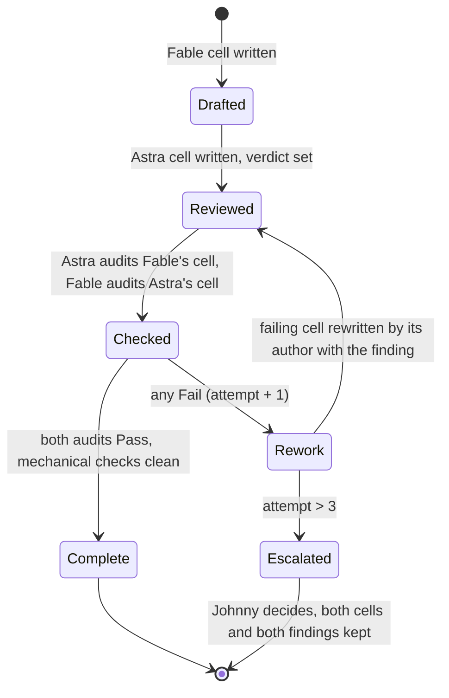
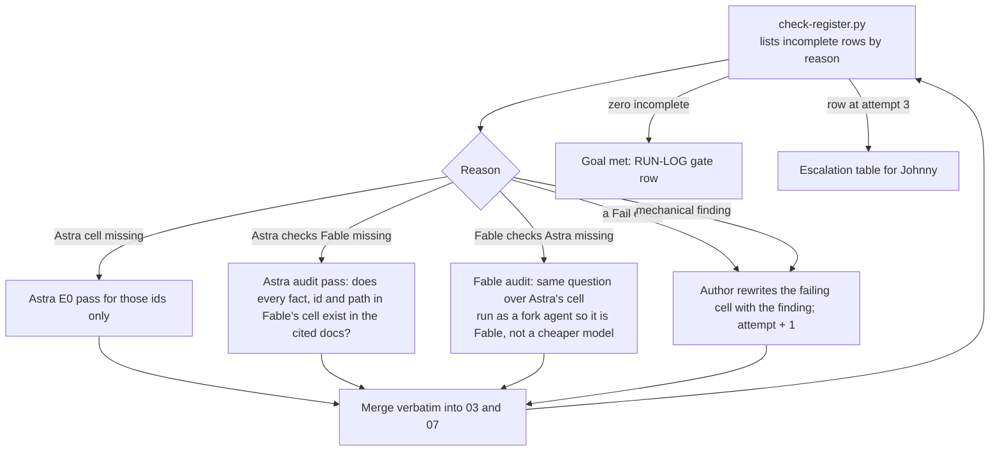

# 12 Register loop: every decision row, both models, verified, nothing hallucinated

| Field | Value |
|---|---|
| Goal | Every decision row in `03` (D) and `07` (DD, MD, MN, AN, AD, CB, SE) reaches `Complete`: Fable's recommendation and reasoning, Astra's recommendation and reasoning, a verdict, Astra's verification of Fable's cell, Fable's verification of Astra's cell, and zero mechanical hallucination findings. The loop runs until the checker reports zero incomplete rows or a row hits its ceiling and is escalated to Johnny |
| Checker | `python3 0_plan/tools/check-register.py` prints the status report and writes `0_plan/ensemble/register-status.md`. Exit 1 while any row is incomplete |
| Review page | `python3 0_plan/tools/build-dashboard.py` renders both registers and this log into `0_plan/ensemble/register-dashboard.html`; the orchestrator republishes it to the same artifact URL after every merge so Johnny can review live: disagreements first, then every row with both cells, both checks and state |
| Merger | `python3 0_plan/tools/merge-ensemble.py astra FILE` fills Astra cells and verdicts; `audit-fable FILE` fills "Astra checks Fable"; `audit-astra FILE` fills "Fable checks Astra"; `astra --rework FILE` overwrites a rewritten Astra cell and resets the check that covers it. Outputs are always saved verbatim under `ensemble/` first |
| Ceilings | 3 rework attempts per row; 4 loop iterations per session; at most 60 ids per Astra pass |
| Version | 0.1, 2026-09-10 |

## 1. Row state machine

| State | Meaning | Cells |
|---|---|---|
| Drafted | Fable's cell exists; Astra's is `Pending E0` | Fable filled |
| Reviewed | Astra's cell exists; Verdict set from Astra's "Agrees with Fable" | Fable, Astra, Verdict |
| Checked | Both verification cells filled with `Pass` or `Fail: <finding>` | plus Astra checks Fable, Fable checks Astra |
| Complete | Both `Pass`, mechanical checks clean | all |
| Rework | A `Fail` exists; the author of the failing cell rewrites it with the finding in hand | attempt counter in `register-status.md` |
| Escalated | Attempt ceiling hit or a first-screen disagreement | Verdict `Escalated`; Johnny or Nari decides |

## 2. The loop

| Step | Who | Input | Output | Merge |
|---|---|---|---|---|
| Status | `check-register.py` | `03`, `07`, the fact corpus | `register-status.md`: counts, incomplete rows with reasons, escalations | none |
| E0 | Astra (`codex exec`, read-only) | The documents and the listed ids | One table row per id: recommendation, reasoning, agrees | Astra cell; Verdict |
| Audit of Fable | Astra | Each id's Fable cell and the documents | `\| ID \| Pass or Fail: finding \|` | "Astra checks Fable" |
| Audit of Astra | Fable, as a fork agent (same model, fresh context) | Each id's Astra cell and the documents | Same format | "Fable checks Astra" |
| Rework | The cell's author | The finding | A rewritten cell that cites what exists | The cell; the check column that covers the rewritten cell resets to `Pending`; the other model's check of the unchanged cell stands |
| Gate | Orchestrator | Zero incomplete | RUN-LOG row `Completeness`, `Pass` | |

## 3. What counts as a hallucination

| Check | Mechanical (`check-register.py`) | Model audit |
|---|---|---|
| An id that does not exist | Yes: every id in a cell must be defined somewhere in `0_plan/` or `1_spec/` | Yes |
| A number with no source | Yes: every number in a cell (counts, dollars, percentages, multipliers) must appear in the fact corpus: `00`, `01`, `08` section 1, `09` section 7, `10`, `11` section 1, or the options cell of the same row | Yes, and whether the number is used correctly |
| A file path that does not exist | Yes: backticked paths checked like `1_spec/tools/check-paths.py` does | Yes |
| A fact attributed to a document that does not contain it | No | Yes: the auditor opens the cited document |
| A quotation that is not in the transcript | No | Yes: the auditor searches `01` |
| Boilerplate or placeholders | Yes: `Pending`, `n/a`, `TBD` without a Q id, `see above`, `as requested`, under 20 words | |
| A verdict that contradicts the cells | No | Yes |
| A change to a cell or row tagged `[SoT:TR-nnn]` | Yes: `truth.py check` fails when an attested statement no longer appears verbatim | Yes: the auditor flags any model edit to an attested statement; only a human re-attests |

A `Fail` names the offending fact, id, number or path so the author can fix that and nothing else.

## 4. Escalation table

Rows that hit the ceiling or carry `Differ` are listed here for Johnny. No row hit the ceiling in the first run; all 22 entries are verified disagreements between the models, each with both reasonings in the register. D-008 was decided by Johnny during the session (`0_plan/` and `1_spec/`). `check-register.py` regenerates the list in `register-status.md`; this table records the decision when it is made.

| # | Row | Decision | Why escalated | Fable | Astra | Johnny or Nari decided | Date |
|---|---|---|---|---|---|---|---|
| 1 | D-004 | Content editing model for Phase 3 | Both models differ after E0 | Decide after DEL-011. If fewer than roughly a dozen pages change per quarter, (a) with a same-day PR path is enough. Otherwise (b). (c) contradicts the off-Webf… | **Choose (b) for routinely changing Phase 3 content, retaining PR editing during Phase 1.** P-05 identifies stale content and missing ownership, while REQ-050 e… | | |
| 2 | D-008 | Location of planning docs | Both models differ after E0 | Rename to `docs/` when the requirements are locked, so the standard build workflow finds them. The v1 checkout has an uncommitted `docs/` that must be merged or… | **Choose (a), keeping the documents in `0_plan/`.** D-013 and the operating model designate `0_plan/` as the requirements and decisions source of truth. The doc… | | |
| 3 | D-014 | Analytics and experimentation platform for the landing | Both models differ after E0 | (b). GA4 stays for continuity and paid-media reporting; PostHog is already among the connected tools. Consent posture (MD-20) applies to both.… | **Choose (a) for launch, reconsidering PostHog after measurement repair and a defined experiment need.** The snapshot records 2,493 organic-social sessions agai… | | |
| 4 | D-015 | Geo-personalization mechanism, if MD-14 or MD-26 adopt it | Both models differ after E0 | (a) if geolocation is adopted at all: the host's edge header needs no third-party call and no consent change, and unknown regions get the default content. Astra… | **Choose (c) for v1, using explicit Texas eligibility copy without automatic geolocation.** The [context](/Users/johnny/projects/gt-school/gt-anywhere-site-v2/0… | | |
| 5 | DD-24 | One-question decision helper | Both models differ after E0 | (a), in M1 or M5. The deciding fact is place and format; the helper routes without reading a table. Derived, not said on the call; flagged… | **Choose (b): omit the one-question helper from v1 and validate the explicit school labels first.** Ability to attend in Georgetown does not determine preferenc… | | |
| 6 | MD-03 | Message match with paid creative | Both models differ after E0 | (a). Paid social is 32 sessions in 28 days today (`10`), so this is a lever for later; the parameter costs little now and the variants double as hook tests (MD-… | **Choose (c) for launch, introducing headline variants when a defined campaign or experiment needs them.** `10` records only 32 tracked paid-social sessions aga… | | |
| 7 | MD-12 | Remarketing hooks | Both models differ after E0 | (a). Door-click custom events cost one event per pixel and let each school retarget its own audience, so a Georgetown-intent parent stops seeing Anywhere creati… | **Choose (b) for new multi-platform remarketing in v1, retaining school-level analytics while activation decisions are resolved.** `10` records 32 paid-social s… | | |
| 8 | MD-26 | The TEFA module | Both models differ after E0 | (a). The strongest offer on either site; "Summer 2026: redeem your funds" is already dated content on the homepage (DD-28)… | **Choose (b) as the foundation, with an optional owned and expiring Texas promotion after its timing is verified.** REQ-026 requires transparent tuition and acc… | | |
| 9 | MN-03 | Door hover, focus and expand | Both models differ after E0 | (a) everywhere; (b) as M1's experiment with a touch fallback, because hover does not exist on the phone (DD-14)… | **Keep door dimensions static, with clear hover and keyboard-focus styling but no lift, scale, or expansion.** `10` shows mobile substantially exceeding desktop… | | |
| 10 | MN-04 | Scroll-driven reveals | Both models differ after E0 | (b). A once-only fade-up under 400 ms on section entry gives sections a sense of arrival without cost; parallax and scroll-linked effects hurt Core Web Vitals (… | **Choose (a): keep below-fold content visible without scroll-driven reveals.** The comparison exists to resolve attendance differences as early as possible (`01… | | |
| 11 | MN-05 | State transitions (comparison toggle, switcher, helper) | Both models differ after E0 | (b). Crossfade between 150 and 250 ms with animated height keeps the layout still while the comparison toggle, the switcher or the helper changes state; an inst… | **Choose (a): update states immediately while keeping controls and layout stable.** Animated height conflicts with MN-10’s explicit transform-and-opacity-only r… | | |
| 12 | MN-07 | CTA micro-interactions | Both models differ after E0 | (a). It is already the brand's pattern and the school sites inherit whatever the landing does (REQ-074 for the fix)… | **Choose (b): simple visual state changes with stable CTA text and accessible names.** CON-03 preserves the brand style, while REQ-074 requires accessible inter… | | |
| 13 | MN-08 | Signature motion per lens | Both models differ after E0 | One signature moment per mock, tied to its lead lens: M2 counts its figures up once because evidence is its argument; M4 scrolls a student-work strip because bu… | **Remove mandatory signature animations and retain only interaction feedback justified by each mock’s task.** REQ-019 asks for five distinct design directions, … | | |
| 14 | MN-15 | Motion in in-app browsers | Both models differ after E0 | (a). Instagram, Facebook and TikTok webviews throttle and render differently from Safari and Chrome, and most sessions are mobile (`10`); serving the reduced-mo… | **Choose (b), using one restrained default across browsers and honoring each user’s reduced-motion preference.** REQ-024 specifically requires testing Instagram… | | |
| 15 | AN-07 | Source of truth for conversions and the wrong-school metric | Both models differ after E0 | (a). GA4 loses sessions in webviews and to consent; records do not. The metric needs the school parameter (DD-25, MD-09) in the application repo… | **Use Supabase records and Crystal-confirmed routing mistakes, with HubSpot reconciled after Q-023.** Fable’s start-school versus enrolled-school mismatch exclu… | | |
| 16 | AN-13 | Product analytics alongside GA4 | Both models differ after E0 | (a). GA4 cannot run experiments or show sessions; the routing behavior on the first screen is exactly what replay reveals… | **Choose (b) initially, adding PostHog only for an approved experiment or diagnostic need.** `10` already contains application-funnel events, while Georgetown r… | | |
| 17 | AN-15 | Internal and development traffic | Both models differ after E0 | (a). Preview, localhost and webflow.io hostnames appear in the production property today (`10` section 1), which pollutes every report and will get worse with p… | **Use a separate development property, a production-host allowlist, and tested internal-traffic exclusions.** `10` already contains localhost, Webflow preview, … | | |
| 18 | AD-04 | Pixels and tags on the landing | Both models differ after E0 | (a). The landing is the top of every paid funnel; a channel without its tag cannot optimize or retarget (AN-09)… | **Deploy only tags for verified active channels through the consent-controlled container.** `10` documents no LinkedIn tag and no visible TikTok campaign traffi… | | |
| 19 | CB-01 | Hosting model on TrueFoundry | Both models differ after E0 | (a). No infrastructure team exists; move to (b) only if data-residency or cost demands it. Verify TrueFoundry's current offering before committing (nothing is i… | **Use TrueFoundry’s managed gateway and decide application hosting separately through DEL-023.** `09` records nothing configured locally, and `08` identifies Jo… | | |
| 20 | SE-08 | Entity consistency for answer engines | Both models differ after E0 | (a). Answer engines resolve an entity by consistency across sources; today GT School resolves to Georgetown and Anywhere describes itself as the organization (`… | **Maintain one governed facts source with distinct umbrella, Georgetown, and Anywhere entity records.** `00` gives Anywhere tuition as $10,400, while Georgetown… | | |
| 21 | SE-10 | AI crawler policy and llms.txt | Both models differ after E0 | (a). chatgpt.com already sends 36 sessions in 28 days without any help (`10`); visibility is the goal (MD-24). Q-027 confirms no policy objection… | **Permit approved discovery crawlers, decide training permissions separately under Q-027, and treat `llms.txt` as an optional experiment.** `10` records 36 Chat… | | |
| 22 | SE-13 | Preview and staging indexation | Both models differ after E0 | (a). Five mocks and every PR preview would otherwise be indexable duplicates of the future root page; Vercel previews already appear in GA (`10`)… | **Protect previews with access control and use crawler-visible `noindex` on any publicly accessible nonproduction pages.** `10` documents preview traffic, and R… | | |
| 23 | D-039 | Scripts and inputs in mocks under D-031 | Hit the three-attempt ceiling on 2026-09-11: Astra agreed with option (a) in substance but failed Fable's cell on checker behaviour it probed in memory; each probe was closed in code with a fixture (twenty-seven now) and the claim was scoped to well-formed engineer-written HTML | (a): one declared inline script of at most 2 KB for the K4 observer moves, radio inputs for the router direction only, both declared with `data-d039` and named in the rationale; a mock declaring nothing needs no mention | Partly: agrees with (a) and with the no-declaration position (E6d, E6e); keeps failing the cell while any in-scope probe passes the checker (E6f to E6h: entity-encoded values, disguised end tags, commented-out markup, markup-like text in scripts) | Pending: Johnny decides (a) or (b); (b) withdraws V6, V8 and M16's interactivity. Astra's final evidence pass (E6p) passed the cell within its stated scope, so the escalation is now a plain approve-or-decline on the substance | 2026-09-11 |

## 5. Log

| Iteration | Date | Rows incomplete before | Passes run | Rows incomplete after | Notes |
|---|---|---|---|---|---|
| 1 | 2026-09-10 | 158 | E0-a merged (26 D rows); E0-b, E0-c, E0-d running | see `ensemble/register-status.md` | Verification columns added; audits not yet run |
| 2 | 2026-09-10 | 156 | E0-b, E0-c, E0-d merged (132 rows: 61 agree, 53 partly, 18 differ); 51 thin Fable cells rewritten; 4 mechanical findings fixed in the checker | 156 Reviewed, awaiting both audits | Audits launched: Astra over Fable's cells (4 passes), Fable over Astra's cells (fork agents) |
| 3 | 2026-09-10 | 156 | Fable audit of Astra cells merged: 155 pass, 3 fail (MD-22, MN-09, MN-15: single-builder fact attributed to `09`, lives in `08` section 4 H7); targeted Astra rewrite launched for those three; Astra audit of Fable cells running | 156 awaiting Astra's audit | Two ambiguous wordings fixed (`00` Q-002, SE-10 Q-027) |
| 4 | 2026-09-10 | 156 | Astra audit of Fable cells merged: 158 audited, 41 fail (quotes not verbatim in `01`, overstated claims, one real inconsistency MN-05); transcript stored in `inputs/` as primary source; 41 Fable cells rewritten with sourced citations; Astra's 3 rewritten cells re-audited by Fable: pass | 41 awaiting Astra re-audit; 115 complete | Ceiling: these rows are at attempt 2 of 3 |
| 5 | 2026-09-10 | 41 | Astra re-audit of the 41 rewritten cells: 36 pass, 5 fail; five cells reworked at attempt 3 (the ceiling) and sent for a final re-audit | 5 awaiting the final re-audit; 151 complete | Any fifth-row failure is escalated, not rewritten again |
| 6 | 2026-09-10 | 5 | Final Astra re-audit: 5 pass. Goal met: 158 rows, 156 complete, 2 superseded, zero mechanical findings | 0 | Complete means verified, not agreed: the 22 `Differ` rows in section 4 await Johnny or Nari |
| 7 | 2026-09-10 | 1 | New row D-027 (source-of-truth enforcement) entered the loop: Astra reviewed (agrees, with a caveat that selective signing alone is weak), Astra's audit failed Fable's claim that an agent cannot produce the signature; Fable reworked the cell and the wording in TRUTH.md, 09 and CLAUDE.md; check-register's evidence corpus restricted to sources of truth after a circularity was found | 1 awaiting re-audit | The corpus fix is itself a drift control: a number in the register no longer counts as evidence for itself |
| 8 | 2026-09-10 | 1 | D-027 passed Astra's audit on attempt 3, the ceiling, after two wording corrections (the signature claim, the reviewer claim); Fable's audit of Astra's D-027 cell passed; MN-12 rewritten with exact device counts and passed. Goal met: 159 rows, 157 complete, 2 superseded, zero mechanical findings | 0 | The stricter evidence corpus (sources of truth only) found one derived total; the loop closed it |
| 9 | 2026-09-11 | 19 | Nineteen rows from the knowledge-base follow-ups (DD-38 to DD-45, MN-16, AN-19, AD-15, D-031 to D-038) ran the full loop in one day: E5a Astra cells (7 agree, 12 partly) and Astra's audit of Fable (3 pass, 16 fail on reference precision); Fable rewrite at attempt 2; E5b (15 pass, 1 fail); Fable's same-model audit of Astra (17 pass, 2 stale reads of K2 mid-rework); E5c rewrote Astra's two cells and re-audited Fable's two at attempt 3; every row Complete | 0 | A cell that asserts a cluster's state while that cluster is being reworked names the date; the checker's number corpus now includes `kb/`, `ensemble/` and `mockups/shared/` so knowledge-base figures count as sourced |
| 10 | 2026-09-11 | 1 | D-039 (scripts and inputs in mocks) hit the three-attempt ceiling: Astra's E6, E6b and E6c each found the checker's behaviour narrower than the cell claimed (attribute matching fooled by `data-type` or a `value`, unquoted submit, spaced `src`, absent-declaration semantics); the code was fixed with twelve in-memory fixture tests, the cell amended, the verdict set to Escalated and Johnny decides; Astra passes E6d to E6p ran as evidence, not as attempts, and E6p passed; each found a further parser probe (values impersonating attributes, a quoted greater-than sign inside a tag, entity-encoded values, a disguised end tag, commented-out markup, markup-like text and comment markers inside scripts, and one regression Fable introduced and Astra caught) and each was closed in code with a fixture; every rule now reads the document through Python's standard-library HTML parser, with thirty-seven in-memory checks including two whole-gate probes on M1 | 1 | The remaining disagreement is design, not fact: whether a mock with no declaration must still name D-039 in its rationale |
| 9 | 2026-09-10 | 3 | Three new rows for the testing suite (D-028 runner, D-029 devices, D-030 analytics assertions) entered the loop | 3 awaiting Astra | Testing-suite decisions go through the standard process before any runner is installed |
| 10 | 2026-09-10 | 3 | Astra reviewed D-028 to D-030: agrees on all three (Playwright Test in `tests/`, real devices for webviews, interception plus DebugView). Astra's audit failed Fable's three cells on an out-of-date id index and two unsupported generalities; cells rewritten with the claims labeled as judgment and re-sent; Fable's audit of Astra's cells running | 3 awaiting both audits | The id index is now rebuilt before every Astra pass |
| 11 | 2026-09-10 | 3 | D-028 to D-030 complete: Astra agrees on all three; Fable's cells passed on attempt 3 after the dependency rule was written into CLAUDE.md's stop-and-ask list and the interception claim was aligned with the testing spec; Fable's audit of Astra's cells passed. Goal met: 162 rows, 160 complete, 2 superseded | 0 | The runner (T-160) now waits only on Johnny's yes |
| 12 | 2026-09-10 | 0 | Research R1 to R4 landed; Fable revised 32 rows to v0.2 on the evidence, conceding to Astra on the headline-variant test, the helper, speculative tags, entity records and six motion rows, and correcting its own facts on cross-links, motion durations and the hero-tone premise; all 32 sent to Astra's audit in one pass | 32 awaiting Astra's audit | Research is how the register moves from v0.1 positions to v0.2 evidence |
| 13 | 2026-09-10 | 32 | Astra audited the 32 revised cells: 26 pass, 6 fail (two truncated quotations, a wrong page for the percentile bar, a certainty about the animation's location, an absence claim overstated, TikTok counted as active); all six corrected at the source and passed re-audit. The checker's evidence corpus now includes the research reports, so a number cited from R1 to R4 counts as sourced. Goal met: 162 rows, 160 complete, 2 superseded | 0 | 11 rows still carry Differ for Johnny or Nari; the rest are agreed and verified |
