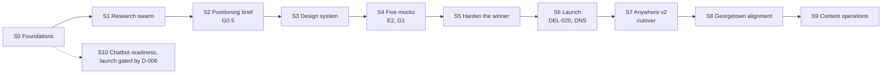
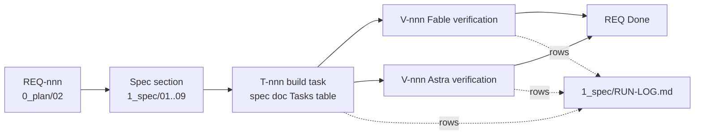

# 00 Scope and traceability

| Field | Value |
|---|---|
| Purpose | What the spec covers, the end-to-end phase plan, how every planning item maps into the spec, and how every requirement is traced to a build task and two independent verifications |
| Derived from | Everything in `0_plan/`. The spec adds no requirement and changes no decision; it makes them buildable. If the spec and `0_plan/` disagree, fix `0_plan/` first, then the spec |
| Ids | The spec reuses planning ids (REQ, DEL, D, DD, MD, MN, AN, AD, CB, SE, MO, CON, P, Q). It adds two series: `T-nnn` build tasks (defined in the "Tasks" table of the spec doc that owns them) and `V-nnn` verification checks (defined in `11-verification-spec.md`). Every id is defined in exactly one place; `0_plan/tools/check-links.py` fails otherwise |
| Version | 0.1, 2026-09-10 |

## 1. In and out of scope

| Surface or system | In scope | Spec doc | Phase |
|---|---|---|---|
| Umbrella landing page at gt.school | Full spec, five mock directions, winner hardened | `03` | S4 to S6 |
| Design system shared by landing and both school sites | Tokens, components, motion tokens, file layout | `04` | S3 |
| GT Anywhere v2 site | Shared shell, page templates, sections, content model | `05` | S7 |
| Georgetown site alignment | Shared shell applied in Webflow; content sections | `05` | S8 |
| Content operations | FAQ, thesis, proof, after-8th, TEFA guide, owners and cadence | `05` section 6 | S9 |
| Analytics and tracking | GTM container, events, key events, cross-domain, consent, dev stream, BigQuery, dashboards | `06` | S0, S5 |
| SEO and AEO | Metadata, structured data, redirects, robots, llms.txt, facts block, prompt log | `07` | S0, S5, S6 |
| Advertising channels | Tags, events, audiences, UTMs, variants, geography, reporting | `08` | S5 onward |
| Chatbot platform readiness | TrueFoundry architecture and readiness steps; launch gated by D-006 | `09` | S10 |
| Build and operations | Models, roles, loop, ceilings, communication, Linear, stall prevention, hallucination and drift checks, run log | `10` | All |
| Verification | Every V check, evidence formats, dual verification | `11` | All |
| Out of scope | The application flow inside apply.gt.school (separate repo; only the school parameter and confirm step are requested there through Linear), HubSpot workflows, ad creative production, TEFA program administration | | |

## 2. End-to-end phases

| Phase | Scope | Entry criteria | Exit criteria | Verified by | Ceiling |
|---|---|---|---|---|---|
| S0 Foundations | Repo topology (D-003), Vercel project (D-020), Linear project (`10` section 6), GTM container and GA fixes (DEL-025, REQ-027, REQ-028), claims register v1 (DEL-018), consent decision (MD-20, Q-016), fonts to woff2, integrity tools green | G0 approved | Every S0 task Done with both verifications; `10` snapshot re-run shows gt.school tagged and `page_view` removed | Fable and Astra V rows | 2 weeks; then escalate what is blocked |
| S1 Research swarm | R1 to R5 (`0_plan/05` section 5) | S0 tools green | `0_plan/07` at v0.2 with research citations; `0_plan/research/R*.md` sourced | Astra E1 on the register | One wave of 4 plus 1; one re-run per agent at most |
| S2 Positioning brief | DEL-017 | S1 done | Nari approves in writing (G0.5) | Nari | Two drafts, then escalate |
| S3 Design system | DEL-004: `tokens.css`, motion tokens, component set, woff2 fonts, layout `design-system/` | G0.5 | Side-by-side proof against both live sites; both verifications | Fable and Astra | 3 build attempts per task |
| S4 Five mocks | M1 to M5 per `03` and `0_plan/05`; gallery; `0_plan/06-mockup-rationale.md`; E2 | S3 done | Nari picks a direction in writing (G1) | E2 (Astra), Fable self-QA, parent-questions test | Wave of 4, then 1; 2 fix rounds |
| S5 Harden the winner | Events (`06`), SEO and structured data (`07`), TEFA module, helper, accessibility, Core Web Vitals, in-app browser QA | G1 | Every landing REQ has T Done, V Fable Pass, V Astra Pass | Fable and Astra | 3 attempts per task; 2 verify rounds |
| S6 Launch | DEL-009 redirects, DEL-020 checklist, DNS, 30-day monitoring | S5 done; Nari and David sign | Root live; rankings and errors monitored for 30 days | Launch checklist, Search Console, GA | One rollback rehearsal before DNS |
| S7 Anywhere v2 | Shared shell, page templates, content per `05` | S6 stable | Cutover PR merged per V2.md | Fable and Astra; harness | Per-page tasks; 3 attempts |
| S8 Georgetown alignment | Shell applied in Webflow (D-005) | S7 shell proven | Both sites pass the IA checklist (DEL-014) | Fable and Astra; Nari | Per-template tasks |
| S9 Content operations | FAQ, thesis, proof, after-8th, TEFA guide; owners and cadence (DEL-011) | S7 | Every content row has an owner and cadence; pages live | Nari; claims register | Per-page tasks |
| S10 Chatbot | Readiness (DEL-023) anytime; launch after D-006's gate | D-017 decided | CB-05 evaluation gate passed | Fable, Astra, Nari, Crystal | Gate, not ceiling |

## 3. Planning to spec coverage

Every planning document and section lands somewhere in the spec. `1_spec/tools/check-coverage.py` enforces the id-level version of this table: every REQ, DEL, D, DD, MD, MN, AN, AD, CB, SE, MO, CON and P id must be referenced by at least one spec document.

| Planning source | Spec destination |
|---|---|
| `00-context.md` (estate, two schools, five facts, vocabulary, journeys) | `01` users and journeys; `02` sitemaps; `03` landing; `10` section 2 (what every agent must know) |
| `01-call-summary` (asks, quotes, action items) | `01` journeys; `03` landing content; `05` school sites; traced through REQ ids |
| `02-requirements-and-deliverables` (REQ, CON, DEL) | Every REQ appears in `12-traceability-matrix.md` with its spec section, tasks and verifications; DELs map to phases in section 2 above |
| `03-decisions-and-open-questions` (D, Q, push-back) | D ids referenced by `10` (operating decisions) and `02` to `09` where they bind; Q ids appear as "TBD (Q-nnn)" wherever a fact is missing |
| `04-architecture` | `02` sitemaps and URL map; `04` design system layout; `06` tag map |
| `05-landing-mockups-plan` (lenses, matrix, research, ensemble, checklist, quality bar) | `03` landing spec (matrix and quality bar), `10` (ensemble and loop), `11` (checklist C-01 to C-15 become V checks) |
| `07-design-decisions` (DD, MD, MN, AN, AD, CB, SE) | Each part has a "Decisions applied" table in its spec doc: A in `03` and `04`, B in `03` and `08`, C in `04`, D in `06`, E in `08`, F in `09`, G in `07` |
| `08-effectiveness` (metrics, principles, considerations A to H) | Metrics in `11` (what verification measures) and `06`; principles in `10` section 2; considerations by phase in section 2 above |
| `09-operating-model` | `10` (extended for agents), `06`, `08` |
| `10-analytics-current-state` | `06` baseline and gaps |
| `11-seo-aeo-plan` | `07` |
| `13-journey-map` (W-01 to W-12, the end-to-end workflows) | `13` test catalogue: every node yields test cases; `12-traceability-matrix.md` gains a test-case column |

## 4. Traceability rule

| Rule | Enforced by |
|---|---|
| Every REQ is referenced by at least one spec section | `1_spec/tools/check-coverage.py` |
| Every REQ in a phase has at least one T task before the phase starts building | `1_spec/tools/build-traceability.py` (matrix column "Tasks" non-empty) |
| Every T has acceptance criteria that name REQ or decision ids, an evidence requirement, and a next step | Task brief template; `1_spec/tools/check-runlog.py` on intake rows |
| Every T is verified by a Fable V row and an Astra V row before it is Done | `10` section 3 loop; `check-runlog.py` rejects Done without both |
| No RUN-LOG row may say "skipped" or "cannot be done" without a reason, an alternative, an owner and an escalation id | `check-runlog.py` |
| Every path named in planning or spec exists, or is declared in `1_spec/tools/planned-paths.txt` | `1_spec/tools/check-paths.py` |
| Every number on a built page has a claims-register row | `1_spec/tools/check-claims.py` (S0 deliverable, T-005) |

## 5. Planned paths (declared so the path checker can tell a plan from a hallucination)

| Path | Created in | Purpose |
|---|---|---|
| `sites/landing/`, `sites/anywhere/` | S0 (D-003) | The two static sites |
| `design-system/` | S3 | Tokens, fonts, partials |
| `0_plan/mockups/`, `0_plan/mockups/shared/`, `0_plan/mockups/M1-two-doors/` … `M5-one-school-two-campuses/` | S4 | The five mocks and gallery |
| `0_plan/research/` | S1 | R1 to R5 reports |
| `0_plan/06-mockup-rationale.md` | S4 | Rationale |
| `1_spec/runs/` | S0 onward | Evidence files per task |
| `1_spec/state/` | S0 onward | Machine-readable task state |
| `vercel.json` | S0 | Redirects and headers (noindex on previews) |
| `robots.txt`, `llms.txt`, `sitemap.xml` per site | S5 | SEO and AEO |

## 6. S0 foundation tasks

Owner model "Johnny" means an account action only a human can take; the builder prepares everything up to that click. Tasks marked stop-and-ask touch a live system and wait for Nari's go before execution, never before preparation.

| ID | Task | Phase | Owner model | Serves | Acceptance | Evidence | Ceiling |
|---|---|---|---|---|---|---|---|
| T-001 | Restructure the v2 tree: move the mirror to `sites/anywhere/`, create `sites/landing/` and `design-system/` (D-003) | S0 | Builder, Sonnet 5 | REQ-032, D-003 | Every mirrored file is byte-identical after the move; the harness serves `sites/anywhere/` and `doctor` passes | Diff report and harness output in `1_spec/runs/T-001.md` | 60 min, 3 attempts |
| T-002 | Vercel project in a team scope, connected to GitHub: previews per PR, `v2` as staging, `main` as production; `x-robots-tag: noindex` plus deployment protection on every non-production deployment, with no robots disallow on those URLs (SE-13, R3 S19) | S0 | Johnny; builder prepares `vercel.json` | D-020, SE-13, REQ-071 | A PR preview renders, returns the noindex header and requires authentication; production branch is `main` | Header capture and project settings screenshot | 60 min |
| T-003 | Linear project "GT Web Redo" with the states, labels, parent issues and templates in `10-build-and-operations-spec.md` section 6; issues created for every S0 task | S0 | Johnny with Fable | D-018, D-022 | Project exists; each T-001 to T-013 has an issue with the task brief as description | Linear ids recorded in the RUN-LOG rows | 60 min |
| T-004 | Claims register v1: every number on the Anywhere pages and gt.school (speed multipliers, percentiles, SAT target, tuition, TEFA amounts, cohort facts), each with source, status and owner (DEL-018) | S0 | Builder, Sonnet 5; Nari approves wording | REQ-022, MD-16, Q-019 | Every figure visible on either site has a row; unresolved conflicts flagged with Q-019 | `0_plan/12-claims-register.md` | 60 min |
| T-005 | `1_spec/tools/check-claims.py`: scans built HTML for numbers, percentages and prices and fails on any figure without a register row | S0 | Builder, Sonnet 5 | REQ-022, MD-16 | Fails on a fixture page with an unregistered figure; passes on the register's figures; wired into the gate checks | Test run output | 60 min |
| T-006 | GTM container with consent mode scaffolding: GA4 configuration, Meta, TikTok, HubSpot tags paused, consent categories defined (AN-03, AN-10); not deployed to a live site in this task | S0 | Johnny; builder prepares the container export | AN-03, AN-10, MD-08, MD-20 | Container export JSON in evidence; tags paused; consent defaults documented | `1_spec/runs/T-006.md` with the export | 60 min |
| T-007 | GA4 fixes (DEL-025): remove `page_view` as a key event; development data stream; BigQuery export on; linker domains extended (AN-05, AN-06, AN-14, AN-15, REQ-028) | S0 | Johnny; builder prepares the change list and re-runs the snapshot | REQ-028, AN-05, AN-06, AN-14, AN-15 | Snapshot re-run shows the corrected key-event list and the new stream; change logged in `0_plan/10` section 5 | Snapshot output before and after | 60 min |
| T-008 | Tag gt.school with the shared stream through the container snippet in Webflow site settings. Stop-and-ask: Nari's go before publishing (D-021) | S0 | Johnny with Nari | REQ-027, AN-01, D-021 | gt.school appears in the hostname report within 48 hours | Snapshot output | 30 min plus the wait |
| T-009 | Fonts: subset woff2 for Literata, Inter Tight and Inconsolata with fallback stacks and a preload plan (DD-01) | S0 | Builder, Sonnet 5 | DD-01, REQ-073, MN-10 | Glyph coverage verified on every page's text; total font weight recorded; screenshots identical to TTF rendering | Sizes, coverage report, screenshots | 60 min |
| T-010 | Consent decision request to Nari and counsel using `1_spec/templates/decision-request.md` (MD-20, Q-016), with the documented default | S0 | Fable | REQ-023, MD-20, AN-10, Q-016 | Request filed; default recorded in the register row | Row in `0_plan/03` and Linear | 30 min |
| T-011 | Tracking plan v1 (DEL-024) from `06-analytics-tracking-spec.md`: every event, parameter, destination and consent category | S0 | Fable | REQ-029, AN-04, AN-08 | Plan lists every event in `06` section 3 with owner and QA step | `1_spec/06-analytics-tracking-spec.md` section 3 marked v1 | 60 min |
| T-012 | Re-mirror the live Anywhere site into `./out`, diff against the mirror, merge the four `feat/gta-*-clear` branches into `v2` (D-009, DEL-016) | S0 | Builder, Sonnet 5 | D-009, DEL-016, REQ-001 | Diff report lists every difference and classifies it; branches merged; harness passes | `1_spec/runs/T-012.md` | 60 min |
| T-013 | Integrity gate for S0: `check-links`, `check-paths`, `check-runlog`, `check-coverage`, `build-index`, `build-traceability` all green; RUN-LOG rows for every S0 task with both verifications | S0 | Watchdog, Haiku 4.5 | D-023 | Every script exits 0; the traceability matrix shows S0 requirements with tasks and verifications | Command output in `1_spec/runs/T-013.md` | 30 min |

## 7. Deliverable to phase map

| Deliverable | Phase | Spec doc |
|---|---|---|
| DEL-001 call summary and requirements | Done in `0_plan/` | `00` |
| DEL-002 sitemap and content audit | S1 | `02` (T-030) |
| DEL-003 journey map | S1 | `01` (T-020) |
| DEL-004 design tokens | S3 | `04` |
| DEL-005 five mocks | S4 | `03` |
| DEL-006 landing spec | S2 to S5 | `03` |
| DEL-007 landing build on a review URL | S5 | `03` |
| DEL-008 KPI baseline | S0 (first snapshot done) | `06` |
| DEL-009 go-live plan | S6 | `02`, `07` |
| DEL-010 unified IA proposal | S1 | `02` (T-033) |
| DEL-011 content inventory | S7 | `05` (T-097) |
| DEL-012 FAQ page | S9 | `05` (T-087) |
| DEL-013 Anywhere v2 build | S7 | `05` |
| DEL-014 Georgetown alignment | S8 | `05` |
| DEL-015 chatbot evaluation | S10 | `09` |
| DEL-016 mirror reconciliation | S0 | `00` (T-012) |
| DEL-017 positioning brief | S2 | `03` (T-040) |
| DEL-018 claims register | S0 | `00` (T-004) |
| DEL-019 risk register | S0 | `10` section 12 and `11` |
| DEL-020 launch checklist | S6 | `11` |
| DEL-021 experiment roadmap | S5 | `08` |
| DEL-022 network learnings ask | S1 | `01`, `03` |
| DEL-023 TrueFoundry readiness | S10 | `09` |
| DEL-024 tracking plan | S0 | `06` (T-011) |
| DEL-025 GA4 configuration fixes | S0 | `00` (T-007) |
| DEL-026 testing suite | S5 (skeletons in S0) | `13` |

## 8. Constraints the spec inherits

| Constraint | How the spec honors it |
|---|---|
| CON-01 no agency | Builders are models; D-007 hand-off package is the only external help path |
| CON-02 design is the limiting skill | Mockup rounds and Nari's G1 are the control points; `03` section 8 |
| CON-03 the brand style stays | DD-19 style envelope in `04` |
| CON-04 start simple | The landing anatomy in `03` has eight sections and no more; additions need a REQ |
| CON-05 Nari is the requirements authority | Every task's acceptance is observable, and Nari accepts visible changes on previews |
| CON-06 `main` untouched until cutover | `10` section 4 branch rules; T-002 environments |
