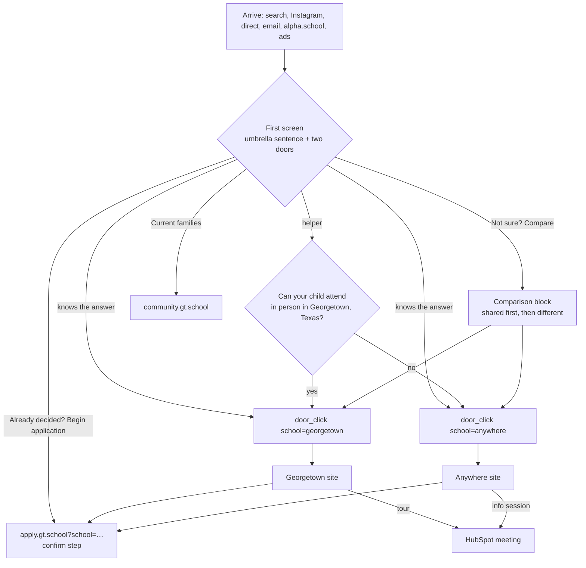

# 01 Users and journeys

| Field | Value |
|---|---|
| Purpose | Who arrives, what they need, where each must end up, and the objections and questions the pages must answer. Every element of the landing and the school sites traces back to a row here |
| Sources | `0_plan/00-context.md` (journeys), `0_plan/01` (Nari's asks), `0_plan/08` sections 4A and 4B (personas, objections), `0_plan/10` (traffic: two thirds mobile; Texas 1,445 of 7,200 sessions; California 692; Florida 440; New York 314) |
| Decisions applied | DD-20, DD-22, DD-23, DD-24, DD-25, DD-26, DD-32, DD-33, MD-01, MD-02, MD-10, MD-15, MD-25, MD-26 |
| Requirements covered | REQ-010, REQ-011, REQ-012, REQ-016, REQ-017, REQ-021, REQ-026, REQ-038, REQ-044, REQ-048, REQ-070 |
| Version | 0.1, 2026-09-10 |

## 1. Problem statements to spec elements

| Problem | What the spec does about it | Where |
|---|---|---|
| P-01 two brands, no recognition value | One umbrella sentence and lockup, a shared shell both sites inherit | `03` section 2, `04` section 5 |
| P-02 "GT School" means Georgetown | The umbrella is the parent in the lockup and in structured data | `03` section 2, `07` section 3 |
| P-03 wrong-school applications | Doors with unmistakable cues, the one-question helper, the school parameter on every application link, a confirm step in the application | `03` sections 2 and 3, `06` section 3, T-110 |
| P-04 weak cross-references, split search (one-way today: gt.school links to Anywhere, never the reverse, R4) | Sibling-school links in the shell, organization structured data, redirect map | `02` section 5, `07` |
| P-05 stale content, no owner | Content inventory with owners and cadence; evergreen rule; one owned TEFA module | `05` section 6 |
| P-06 thin content, no application process | Application steps on the landing and an Admissions page per school | `03` section 2, `05` section 2 |
| P-07 no self-serve answers | FAQ page with schema; answer-shaped content; the chatbot gated behind it | `05` section 3, `07` section 6, `09` |
| P-08 enrolled families call the general line | "Current families" route in the header; phone below the fold | `03` section 2, `02` section 4 |
| P-09 little visibility into conversion | Tracking plan, key-event cleanup, wrong-school metric | `06` |
| P-10 no agency, limited design capacity | Model builders, mock rounds, Nari's G1, the hand-off package | `10` section 1, D-007 |

## 2. Personas

| Persona | Situation | What they need to see first | Door | Primary CTA | Secondary CTA | Top objections | Journey | Evidence |
|---|---|---|---|---|---|---|---|---|
| A. Texas-local parent of a bored high achiever | Within commuting distance of Georgetown; child under-challenged at a strong public school; TEFA-eligible for Anywhere too | That there are two ways to attend, and that one is a campus nearby | Georgetown, with Anywhere visible as the alternative | "Explore the Georgetown campus" | "Book a campus tour" (REQ-044) | Commute, tuition (Q-011), what after 8th (Q-013), is my child gifted enough | J1 then J3 | Texas is the largest region in GA (1,445 sessions); MD-26 TEFA module applies |
| B. Remote parent of a profoundly gifted child | No local option; often already homeschooling or in an online program | That Anywhere is a full school with peers, not a tutoring product | Anywhere | "Explore GT Anywhere" | "Join a virtual info session" | Socialization, screen time and AI, time zones, intensives travel (Q-017), accreditation | J2 then J3 | California, Florida, New York, Washington in the top regions |
| C. Informed comparer | Has read about Alpha, Davidson, Stanford OHS; wants facts and proof | Verifiable figures with footnotes, the admissions bar, the difference from Alpha | Either; reads the comparison first | "Not sure? Compare" then a door | FAQ, proof page (REQ-043) | Claims credibility (Q-019), price versus value, "then what?" after 8th | J2 | AI-assistant and organic search entries (`0_plan/10`) |
| D. Current family | Wants a schedule, a contact, the community | The current-families route before any marketing | None | "Current families" (header) | Support contact on the hub | Finding the right phone number | J4 | 00:17:28; community.gt.school gets 366 sessions in 28 days |

## 3. Journeys as flows

| Journey | Entry | Steps on the landing | Exit | Events (see `06` section 3) | Success signal |
|---|---|---|---|---|---|
| J1 aware | Brand search, Instagram, alpha.school | Reads the umbrella sentence; sees two doors; may open the comparison | A school site | `door_click`, `compare_view` | Door click-through above 60 percent |
| J2 interested | Search, AI assistant, email | Comparison; proof strip; application steps; secondary CTA | School site, FAQ, tour or info session | `compare_view`, `cta_secondary_click`, `outbound_school_site` | Bookings; pages per session |
| J3 ready | Direct, retargeting, email | Door or the direct-to-application link | apply.gt.school with `school=` set | `door_click`, `cta_apply_click{school, placement}` | Application starts per school; wrong-school rate below 2 percent |
| J4 enrolled | Direct, email | Header utility link | community.gt.school (Q-002) | `families_click` | Fewer calls to the general line |

## 4. Objection inventory

| Objection | Persona | Where it is answered | Content source | Status |
|---|---|---|---|---|
| Is my child gifted enough? | A, B | Landing: the admissions bar stated ("90th percentile and above"); FAQ: accepted evidence | Site copy (verified); Q-012 for evidence types | Partly answered |
| Socialization | B | Comparison row "peers and community"; Anywhere site; intensives | Site copy: "virtual cohorts", quarterly intensives | Answered on the site |
| Screen time and AI-driven learning | B, C | FAQ; thesis page (REQ-042); "a day at GT" visual (DD-34) | Site: two hours of academics, afternoons for projects | Phase 2 content |
| Accreditation and transcripts | B, C | Proof strip and footer facts block: Cognia accreditation | Site (accreditation link present) | Answered |
| What follows 8th grade? | A, B, C | One agreed sentence in the comparison or application steps; FAQ | Q-013 | Blocked on Q-013 |
| Tuition and aid | A, B | Comparison row "tuition and access": Anywhere $10,400 and TEFA; Georgetown TBD (Q-011) | Site; Q-011 | Blocked on Q-011 |
| TEFA eligibility and timing | A | TEFA module (MD-26) with the current window; FAQ | Site ("Summer 2026: redeem your funds"); Q-021 | Blocked on Q-021 |
| Parent workload in a virtual school | B | FAQ; Anywhere academics page | Q-004 (top-100 FAQ) | Phase 2 |
| Time zones | B | FAQ; Anywhere site | Q-004 | Phase 2 |
| Intensives travel | B | Comparison row "in-person time"; intensives page | Q-017 | Blocked on Q-017 |
| How is this different from Alpha? | C | Positioning brief drives the umbrella sentence; FAQ answers directly; not a competitor table on the landing (MD-18) | DEL-017 | Phase 2 |
| Are the results real? | C | Footnoted figures only (DD-07); proof page in Phase 2 | Claims register (DEL-018); Q-019 | Blocked on Q-019 |

## 5. The parent-questions test

Used by E2 and by the five-parent test (REQ-012). A question the landing defers must be one click away.

| # | Question | Landing answers it | Or one click to |
|---|---|---|---|
| 1 | What is GT School? | Umbrella sentence (DD-20, DD-33) | |
| 2 | Who is it for? | "Gifted students, 90th percentile and above" in the sentence or the doors | FAQ |
| 3 | In person or online, and where? | The two doors with place and format cues (DD-04) | |
| 4 | What is the same and what differs? | Comparison block (DD-06) | |
| 5 | What does it cost, or where do I find out? | Comparison row "tuition and access" (MD-13, REQ-026) | School site Admissions |
| 6 | How do I apply and what are the steps? | Application steps section (REQ-016) | apply.gt.school |
| 7 | Is it accredited and what are the outcomes? | Proof strip and footer facts (DD-07, DD-17) | Proof page (REQ-043) |
| 8 | How do I reach a human? | Admissions email; secondary CTA (MD-02, MD-11) | HubSpot meeting |

## 6. The decision helper (DD-24)

| Element | Specification |
|---|---|
| Placement | Under the doors on mobile, beside them on desktop; hidden without JavaScript (doors still work) |
| Copy | "Not sure which is right for your family? Can your child attend in person in Georgetown, Texas?" Buttons: "Yes, we are nearby" and "No, we would attend online" |
| Logic | Yes highlights the Georgetown door and scrolls to it; No highlights the Anywhere door. Neither hides the other door (DD-26) |
| Events | `helper_answer{route}` then the normal `door_click` (`06` section 3) |
| Qualification | Soft only (MD-15): no eligibility question in v1 |
| Motion | Crossfade 150 to 250 ms with space reserved so nothing shifts; instant under reduced motion (MN-05, MN-10, MN-11) |
| Acceptance | REQ-012: five of five test parents choose correctly within ten seconds with the helper available |

## 7. Tasks

| ID | Task | Phase | Owner model | Serves | Acceptance | Evidence | Ceiling |
|---|---|---|---|---|---|---|---|
| T-020 | Journey map document (DEL-003): the four flows above with entry sources from GA, exits, events and success signals, reviewed by Nari | S1 | Builder, Sonnet 5; Fable reviews | REQ-038, DEL-003, MO-1 | Every journey has an entry, steps, exit, events and a signal; Nari approves | `0_plan/13-journey-map.md` | 60 min |
| T-021 | Objection inventory completed with Crystal: every objection in section 4 gets an answer location and a content owner | S1 | Fable with Crystal | REQ-036, Q-004, Q-012 | No row left without an owner | Updated section 4 | 60 min |
| T-022 | Parent-questions test protocol: recruit five parents (Nari's network), script, ten-second timing, scoring sheet | S4 | Fable; Nari recruits | REQ-012 | Protocol written; five parents scheduled before G1 | `1_spec/runs/T-022.md` | 60 min |
| T-023 | Decision helper copy and logic spec finalized, including the no-JavaScript state and reduced-motion state | S4 | Builder, Sonnet 5 | DD-24, MD-15, MN-05 | Section 6 acceptance observable in the mock that carries the helper | Screenshots per state | 60 min |
| T-024 | Persona validation with Nari and Crystal: confirm or correct section 2, especially objections and CTAs per persona | S1 | Fable | REQ-039, DEL-022 | Both confirm in writing; changes logged | Call summary in `0_plan/` | 30 min plus the call |
