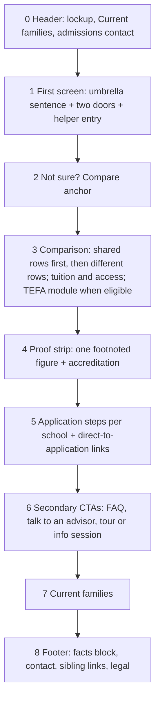

# 03 Landing page specification

| Field | Value |
|---|---|
| Purpose | The buildable specification of the umbrella landing page at gt.school: anatomy, content slots, states, responsive behavior, accessibility, motion, events, SEO, performance, the five mock directions, and acceptance per requirement |
| Sources | `0_plan/05` (lenses, matrix, quality bar, checklist), `0_plan/07` Parts A, B, C, `0_plan/08` (principles), `0_plan/00` (facts), `1_spec/01` (journeys, parent questions, helper) |
| Decisions applied | DD-01 to DD-14, DD-16, DD-17, DD-19 to DD-37; MD-01 to MD-07, MD-09 to MD-18, MD-20 to MD-26; MN-01 to MN-15; SE-05, SE-06, SE-09, SE-10, SE-13; AN-04; D-011, D-015; CON-03, CON-04. DD-15 and DD-18 are superseded by Part C and AN-04 |
| Requirements covered | REQ-010 to REQ-026, REQ-070, REQ-071, REQ-073, REQ-074 |
| Version | 0.1, 2026-09-10 |
| Hosting | Static HTML in this repo deployed on Vercel (D-002), under `sites/landing/` (D-003) |

## 1. Anatomy

| # | Section | Job | Must contain | Must not contain | Decisions |
|---|---|---|---|---|---|
| 0 | Header | Identify the umbrella; route enrolled families away from marketing | Umbrella lockup (placeholder until Q-001); "Current families" link; admissions email or "Talk to an advisor" | A menu; a phone number | DD-11, DD-12, DD-13, DD-32, MD-11 |
| 1 | First screen | Orientation, then choice | One umbrella sentence that decodes GT and names two ways to attend (DD-20, DD-33); two doors of equal weight (DD-26) with school name in full (REQ-018), one-line description, one cue set (label plus icon plus photo, DD-04), one CTA (DD-05); a provenance line naming the Alpha network once (MD-17) | Anything else above the CTAs on 390px (REQ-011); figures (DD-07 puts them in section 4); wealth cues (DD-10) | DD-03, DD-20, DD-21, DD-26, DD-33, MD-04, MD-17, MD-25 |
| 2 | Compare anchor | Reassure the undecided | "Not sure which is right for your family? Compare the two" as an in-page link | | DD-23 |
| 3 | Comparison | Show what is shared, then what differs | Attribute table (DD-06): rows in order Same school, same academics; The day (schedule visual in one mock, DD-34); Where and how; Peers and community; In-person time; Advisors; Admissions; Tuition and access (MD-13, REQ-026); What follows 8th grade (REQ-048, TBD Q-013). Doors repeated beneath (DD-23). TEFA module for Texas visitors (MD-26; behavior per D-015) | Countdowns; unverified figures; competitor names (MD-18) | DD-06, DD-21, DD-22, DD-23, DD-34, MD-13, MD-25, MD-26 |
| 4 | Proof strip | Earn belief with one verifiable figure | At most one figure with a footnote to an Approved claims-register row (DD-07, REQ-022); the accreditation wording from the register and no Cognia mark until Q-033 closes (DD-17); one parent quote only if its subject is a verified GT student (MD-05, Q-034) | The three multipliers; targets stated as results | DD-07, DD-09, DD-17, MD-05, MD-16 |
| 5 | Application steps | Answer "how do I apply" | The steps per school (REQ-016; content TBD Q-007), each school's "Begin application" link carrying `school=` (DD-25, MD-09); the admissions bar stated plainly (MD-06, MD-15) | A form (MD-01); a hard eligibility gate | DD-25, MD-01, MD-06, MD-10, MD-15 |
| 6 | Secondary CTAs | Serve the not-yet-ready | FAQ link; "Talk to an advisor" (HubSpot meeting); per school: "Book a campus tour" or "Join a virtual info session" (REQ-044) | Email capture | MD-02 |
| 7 | Current families | Support intent | Link to the hub (Q-002) with a support contact | The general phone number above the fold | DD-13, DD-32, REQ-017 |
| 8 | Footer | Entity and trust | Facts block (SE-08); admissions email; phone; sibling and umbrella links; legal; accreditation | | DD-17, MD-11, SE-06, SE-08 |

## 2. Content slots

Every slot names its source. A slot whose source is a Q id ships with a visible placeholder in the mock and is blocked for production until the question closes. No slot may carry a number without a claims-register row (REQ-022).

| Slot | Section | Copy rule | Source | Status |
|---|---|---|---|---|
| Umbrella sentence | 1 | One sentence, under 25 words, decodes "gifted and talented", names both ways to attend, plain words (DD-30), institutional and warm (DD-16). Working draft: "GT School is a selective school for gifted and talented children, in person at our Georgetown, Texas campus or online from anywhere." | DEL-017 positioning brief fixes the final wording | Fixed (G0.5 item 1); `0_plan/mockups/shared/copy.md` |
| Provenance line | 1 | "The gifted school in the Alpha School network." Once, small | MD-17; homepage already states the affiliation | Ready |
| Door: Georgetown | 1 | Name "Georgetown Campus"; line "In person, Georgetown, Texas"; CTA "Explore the Georgetown campus" | DD-27 (Nari to confirm the label) | Fixed in `copy.md` v1 (T-041) |
| Door: Anywhere | 1 | Name "GT Anywhere"; line "Online, from anywhere, with quarterly in-person intensives"; CTA "Explore GT Anywhere" | DD-27; site copy | Fixed in `copy.md` v1 (T-041) |
| Helper | Phase 2 | Deferred: DD-24 revised after R3 to omit the helper from v1; the spec in `01` section 6 stays as the Phase 2 experiment gated on TC-073 | DD-24, Q-032 | Deferred |
| Comparison rows | 3 | One short cell per school per row; facts only | Q-007, Q-008, Q-011, Q-013, Q-017; site copy for the 90th percentile bar and TEFA | Blocked on questions |
| Tuition and access | 3 | Anywhere: the Approved TEFA wording (CR-021, CR-022 conflict to resolve). Georgetown: "Tuition on request" until Q-011, because the campus site discloses no figure, only a $10,000 founding-family scholarship (CR-024) | Claims register rows; MD-13, REQ-026 | Georgetown "Tuition on request" decided (G0.5 item 4); Anywhere wording in `copy.md`, CR-021/CR-022 conflict flagged |
| TEFA module | 3 | "Texas families: the TEFA voucher covers GT Anywhere tuition in full. <window>" with an owner and an expiry date in the content file | MD-26; Q-021 for window and disclaimers | Default copy in `copy.md`; window, owner and expiry blocked on Q-021 |
| Proof figure | 4 | One figure, footnoted; the evidence favors 3X (R4: the only figure gt.school uses, matching the refund-policy growth-factor guarantee, CR-004, CR-007, CR-008) once Nari approves the row (Q-019) | DEL-018 | Withheld by decision (G0.5 item 2); the strip carries four register-backed facts instead (`copy.md` section 4) |
| Steps | 5 | Four steps per school, one line each | Q-007; the Anywhere flow is Interest, Apply, Enroll, Tuition per prior sessions | Four generic steps in `copy.md`, flagged Q-007 |
| Secondary CTAs | 6 | "Read the FAQ", "Talk to an advisor", "Book a campus tour", "Join a virtual info session" | MD-02; HubSpot meeting links from Nari | Destinations set in `copy.md` (contact page until meeting links exist); "Talk to admissions" replaces "Talk to an advisor" after G0.5 item 5 |
| Facts block | 8 | Identical wording on every surface | SE-08; claims register | Fixed in `copy.md` section 8 |

## 3. States

| State | Trigger | Behavior | Decisions |
|---|---|---|---|
| Default | Any visitor | Doors in default order Georgetown, Anywhere; TEFA module hidden or shown per D-015 | DD-14, DD-26 |
| Texas visitor | Edge geolocation header, if D-015 adopts (a); Astra recommends (c) no geolocation in v1, so the mocks ship the module as explicit copy visible to everyone and the geolocation variant behind a flag | TEFA module shown; door order unchanged | MD-14, MD-26, D-015 |
| Headline variant | `?v=` present | The single launch headline renders regardless (MD-03 revised after R3); the value is recorded as a user property so the volume trigger (Q-031) can be measured | MD-03, AD-08 |
| Helper answered | Phase 2 experiment only | Not in v1 (DD-24 revised after R3) | DD-24, Q-032 |
| No JavaScript | Script blocked | Doors, comparison, steps and links work; nothing on the page depends on script | REQ-070 |
| Reduced motion | `prefers-reduced-motion` | All non-essential motion off; helper swaps instantly | MN-11 |
| In-app browser | Instagram, Facebook, TikTok webviews | Same layout; motion reduced set (MN-15); links open in the webview; parameters carry school and campaign (AN-06) | REQ-024, MN-15 |

## 4. Responsive specification

| Breakpoint | Layout | Rules |
|---|---|---|
| 390px (design first) | Umbrella sentence; doors stacked, Georgetown then Anywhere; helper below the doors; compare anchor; comparison as a two-column table with sticky school headers; all sections single column | The first screen fits the doors' CTAs above the fold on a 390 by 844 viewport; tap targets at least 44px; no horizontal scroll; no sticky apply bar (DD-14) |
| 768px | Doors side by side; comparison full table | Check only, no separate design |
| 1440px | Doors side by side with the helper beside or beneath; one mock attempts the comparison inside the first viewport (DD-03) | Maximum content width from tokens; typography scale from tokens |

## 5. Accessibility (REQ-074, DD-36)

| Rule | Detail |
|---|---|
| Landmarks | `header`, `main`, `footer`, `nav` for the header links; one `h1` (the umbrella sentence or the lockup, decided per mock and recorded) |
| Contrast | WCAG AA for all text, including door text over photos (overlay or solid panel) |
| Focus | Visible focus on every link and button; skip link to main |
| Images | Alt text describing the cue ("students in a Georgetown classroom", "a student learning at home") |
| Reading | Literata for body text; sentences under 20 words in the first screen |
| Motion | Reduced-motion state verified in a browser (C-15) |
| Testing | axe through Playwright on every mock; manual keyboard pass |

## 6. Motion specification

| Motion decision | Applied on the landing |
|---|---|
| MN-01 job of motion | Support orientation and choice only; no signature moments (revised after R2) |
| MN-02 hero entrance | None or opacity only under 300 ms; the LCP element renders on first paint |
| MN-03 door hover | Static dimensions; hover and focus styling only (revised after R2) |
| MN-04 scroll reveals | None; content visible as it loads (revised after R2) |
| MN-05 state transitions | Instant, with space reserved so nothing shifts (revised after R2) |
| MN-06 video | None on the first screen; click-to-play behind a poster below the fold at most |
| MN-07 CTA micro-interaction | The sites' hover text-swap kept, duplicate name hidden from assistive tech |
| MN-08 signature moment | None (revised after R2); mocks differ through layout, hierarchy, density, imagery and copy |
| MN-09 stack | CSS and IntersectionObserver in mocks; GSAP reconsidered for the winner only if needed |
| MN-10 performance budget | Transform and opacity only; 100, 200 or 300 ms (R1); zero layout shift |
| MN-11 accessibility | `prefers-reduced-motion` honored; pause control over five seconds |
| MN-12 mobile | Touch equivalents; budgets halved; no scroll hijacking |
| MN-13 tokens | Three evidenced durations and one easing from `04` |
| MN-14 continuity | Shared header persists across the hop |
| MN-15 in-app browsers | One restrained set everywhere; webviews get the layout test matrix, not a motion variant (revised) |

The motion decisions are MN-01 to MN-15. Per mock stances are in `0_plan/05` section 6. Every mock's rationale row carries a motion spec table (what animates, trigger, duration, easing, reduced-motion behavior). Hard limits after R1 and R2: transform and opacity only; only the evidenced 100, 200 and 300 ms durations (MN-10, MN-13); nothing animates the Largest Contentful Paint element before first paint (MN-02); no scroll reveals, lifts or signature moments (MN-01, MN-03, MN-04, MN-08 revised); hover styling has a touch equivalent (MN-12); CSS only in mocks (MN-09); motion tokens from `04` (MN-13).

## 7. Events

Events are specified in `06` section 3 (AN-04) and implemented only in the winner (S5), through the GTM container. The mocks carry `data-event` attributes so the wiring is mechanical.

| Element | Event | Parameters |
|---|---|---|
| Door CTA | `door_click` | `school`, `placement` (first_screen or after_comparison), `variant` |
| Compare anchor and comparison in view | `compare_view` | `variant` |
| Helper answer | `helper_answer` | `route` (georgetown or anywhere) |
| Begin application link | `cta_apply_click` | `school`, `placement` |
| Secondary CTA | `cta_secondary_click` | `type` (faq, advisor, tour, info_session) |
| Current families | `families_click` | |
| TEFA module in view | `tefa_module_view` | `region_source` (geo or default) |
| Outbound to a school site | `outbound_school_site` | `school` |

## 8. SEO and structured data

Per `07`: title "GT School: a selective school for gifted children, in Georgetown, Texas and online"; meta description under 155 characters from the claims register; canonical `https://gt.school/`; `EducationalOrganization` with two `subOrganization` entries (SE-05); Open Graph image local; `robots.txt` allows AI crawlers per SE-10 and Q-027; previews `noindex` (SE-13); answer-shaped definition paragraph (SE-09).

## 9. Performance budget

| Metric | Budget | Decisions |
|---|---|---|
| Largest Contentful Paint, mobile | Under 2.0 s on a mid-range phone over 4G | REQ-073, MN-02 |
| Cumulative Layout Shift | 0 | MN-10 |
| Total transfer, first screen | Under 400 KB; whole page under 1 MB excluding shared images | Quality bar in `0_plan/05` section 9 |
| JavaScript | Mocks: none external except fonts. Production: the GTM container only, loaded after consent and after first paint | MN-09, AN-03 |
| Fonts | Subset woff2, display face preloaded, `font-display: swap` with tuned fallbacks | T-009 |

## 10. The five mock directions

Each mock is a complete page that satisfies sections 1 to 9 and differs in the lens order, visual direction and signature moment recorded in `0_plan/05` section 4. What varies and what does not:

| Mock | Lens order | What varies | What is fixed | Known trade-off | Asset dependency (DD-31) |
|---|---|---|---|---|---|
| M1 Two Doors | L1, L2, L4, L3 | Split hero with explicit place and format labels; comparison directly below (the helper is deferred to Phase 2, DD-24) | Sections 0 to 8 all present | Split hero does not scale past two campuses (DD-21) | Two photos, one per school, from existing site assets |
| M2 The Institute | L3, L4, L1, L2 | Statement plus three proof figures; mono data labels in Inconsolata | Only register-backed figures, so until Q-019 the figures are placeholders flagged in the mock | Cold register risk (DD-09) | None beyond type |
| M3 Private Quiet | L4, L2, L1, L3 | Large Literata display; the palette at its most restrained; a flagged dark-surface variant (DD-19) | Every screen still carries a fact (DD-29) | Big type over thin content is the failure Nari named | None |
| M4 Builders | L3, L1, L2, L4 | Full-bleed student-work image; a "what students built" strip | No stock; existing photos only (DD-08) | Photo quality we do not control | Existing intensives and academics photos; fallback is typographic |
| M5 One School, Two Campuses | L2, L1, L3, L4 | The merged token set in full; the campus switcher as the door component; shared header and footer the school sites inherit | The design system deliverable itself (DEL-004) | Least dramatic | None |

## 11. Acceptance per requirement

| # | Requirement | Acceptance on the landing | Verified by |
|---|---|---|---|
| 1 | REQ-010 | The page exists at the agreed URL (D-001) and presents both schools under the umbrella | V-010 |
| 2 | REQ-011 | On 390 by 844 nothing but the umbrella sentence, provenance line, doors and helper entry appears above the CTAs | V-011 |
| 3 | REQ-012 | Five of five test parents pick the right school within ten seconds (protocol T-022) | V-012 |
| 4 | REQ-013 | The comparison block exists with shared rows first, then differences, and is reachable from the first screen | V-013 |
| 5 | REQ-014 | Tokens match `04`; no palette or type outside the envelope without a flagged departure; Holly's element or its flagged placeholder | V-014 |
| 6 | REQ-015 | Screenshots at 390 and 1440 reviewed; no horizontal scroll; tap targets at least 44px | V-015 |
| 7 | REQ-016 | Application steps present per school or one click away, content verified by Crystal | V-016 |
| 8 | REQ-017 | "Current families" in the header; general number absent from the first screen | V-017 |
| 9 | REQ-018 | Full school names in every label | V-018 |
| 10 | REQ-019 | Five distinct mocks with rationale; Nari picks in writing | V-019 |
| 11 | REQ-020 | Every element in section 7 carries a `data-event` attribute; events fire in DebugView on the winner | V-020 |
| 12 | REQ-021 | The umbrella sentence decodes GT; the provenance line names the network at the decided prominence | V-021 |
| 13 | REQ-022 | `check-claims.py` passes; every figure footnoted | V-022 |
| 14 | REQ-023 | Consent posture implemented before any event fires (winner) | V-023 |
| 15 | REQ-024 | Screenshots from Instagram, Facebook and TikTok in-app browsers on iOS and Android | V-024 |
| 16 | REQ-025 | Events documented in `06`, visible in GA4 with parameters; baseline captured | V-025 |
| 17 | REQ-026 | Tuition and access stated the same way for both schools, or Georgetown marked "see campus site" until Q-011 | V-026 |
| 18 | REQ-070 | Both application links carry the correct `school=`; no form present | V-041 |
| 19 | REQ-071 | Redirects and canonicals in place at go-live (`02` section 3) | V-038 |
| 20 | REQ-073 | Lighthouse mobile at or above today's Anywhere home score; LCP under 2.0 s | V-043 |
| 21 | REQ-074 | axe clean; keyboard pass; reduced-motion verified | V-044 |

## 12. Tasks

| ID | Task | Phase | Owner model | Serves | Acceptance | Evidence | Ceiling |
|---|---|---|---|---|---|---|---|
| T-040 | Positioning brief (DEL-017): umbrella promise, per-school promise, proof, tone, affiliation stance, price and access stance; one page; Nari approves (G0.5) | S2 | Fable; Astra reviews | MD-04, MD-17, MD-18, MD-25, DEL-017 | Nari's written approval | `0_plan/15-positioning-brief.md` | 2 drafts |
| T-041 | Landing content spec v1 (DEL-006): every slot in section 2 filled or marked with its Q id; claims rows referenced | S3 | Builder, Sonnet 5; Nari and Crystal review | REQ-016, REQ-018, REQ-022, REQ-026 | No slot without a source | Section 2 updated | 60 min |
| T-042 | Build M1 Two Doors | S4 | Builder, Sonnet 5 | REQ-010, REQ-011, REQ-012, REQ-013, REQ-014, REQ-015, REQ-016, REQ-017, REQ-018, REQ-021, DD-24 | Quality bar; sections 1 to 9; screenshots 390 and 1440 | `0_plan/mockups/M1-two-doors/`, `1_spec/runs/T-042.md` | 60 min, 3 attempts |
| T-043 | Build M2 The Institute | S4 | Builder, Sonnet 5 | REQ-010, REQ-011, REQ-012, REQ-013, REQ-014, REQ-015, REQ-016, REQ-017, REQ-018, REQ-021, plus DD-07, DD-09 | Same; figures flagged until Q-019 | `0_plan/mockups/M2-the-institute/` | 60 min, 3 attempts |
| T-044 | Build M3 Private Quiet | S4 | Builder, Sonnet 5 | REQ-010, REQ-011, REQ-012, REQ-013, REQ-014, REQ-015, REQ-016, REQ-017, REQ-018, REQ-021, plus DD-10, DD-19, DD-29 | Same; dark variant flagged | `0_plan/mockups/M3-private-quiet/` | 60 min, 3 attempts |
| T-045 | Build M4 Builders | S4 | Builder, Sonnet 5 | REQ-010, REQ-011, REQ-012, REQ-013, REQ-014, REQ-015, REQ-016, REQ-017, REQ-018, REQ-021, plus DD-08, DD-31 | Same; asset dependency declared | `0_plan/mockups/M4-builders/` | 60 min, 3 attempts |
| T-046 | Build M5 One School, Two Campuses | S4 | Builder, Sonnet 5 | REQ-010, REQ-011, REQ-012, REQ-013, REQ-014, REQ-015, REQ-016, REQ-017, REQ-018, REQ-021, REQ-032, REQ-047, DD-21, DD-34 (this mock carries the schedule visual) | Same; consumes the full token set and partials from `04` | `0_plan/mockups/M5-one-school-two-campuses/` | 60 min, 3 attempts |
| T-047 | Gallery `0_plan/mockups/index.html` and `0_plan/06-mockup-rationale.md` with one row per mock: lens order, hypothesis, every decision traced, motion spec, asset dependency | S4 | Builder, Sonnet 5; Fable reviews | REQ-019, C-07, C-10 | Every DD, MD, MN applied appears in a rationale row | Files | 60 min |
| T-048 | Self-QA per mock: screenshots 390 and 1440, console clean, links resolve, axe pass, reduced-motion screenshot | S4 | Watchdog, Haiku 4.5 | C-03, C-04, C-15 | Evidence files per mock | `0_plan/mockups/shared/screenshots/` | 60 min |
| T-049 | E2: Astra reviews the five mocks with screenshots attached, scores lenses and requirements, runs the parent-questions test | S4 | Astra | REQ-012, REQ-019 | `0_plan/ensemble/E2-mocks.md` filled | File | 1 pass, 1 re-run |
| T-050 | Fix pass from E2 findings, or decline with reason | S4 | Builders, Sonnet 5 | | Every finding applied or declined in the RUN-LOG | RUN-LOG rows | 2 rounds |
| T-051 | Five-parent test run per T-022 protocol; results recorded | S4 | Fable; Nari recruits | REQ-012 | Five of five, or findings | `1_spec/runs/T-051.md` | 1 run, 1 re-run after fixes |
| T-052 | G1 package for Nari: gallery, rationale, register, test results, recommendation | S4 | Fable | REQ-019, DEL-005 | Nari picks a direction in writing | RUN-LOG gate row | 1 |
| T-053 | Comparison facts verified with Crystal and Nari (Q-007, Q-008, Q-011, Q-017); claims register rows added | S5 | Fable with Crystal and Nari | REQ-013, REQ-016, REQ-026 | Every comparison cell sourced | Register rows | 60 min plus the answers |
| T-054 | TEFA module: content file with window, wording, owner, expiry; display rule per D-015 | S5 | Builder, Sonnet 5 | MD-26, MD-14, DD-28 | Module renders from the content file; expiry hides it | Screenshots; content file | 60 min |
| T-055 | Decision helper in production: logic, states, events, reduced motion | S5 | Builder, Sonnet 5 | DD-24, MD-15, MN-05 | `01` section 6 acceptance | Screenshots per state; DebugView | 60 min |
| T-056 | Event wiring through the container (AN-04) with DebugView verification | S5 | Builder, Sonnet 5 | REQ-020, REQ-025 | Every section 7 event fires with parameters | DebugView captures | 60 min |
| T-057 | SEO: metadata, structured data, robots, llms.txt, canonical, Open Graph (per `07`) | S5 | Builder, Sonnet 5 | SE-05, SE-06, SE-09, SE-10, REQ-045 | Rich-results validator passes; robots verified | Validator output | 60 min |
| T-058 | Accessibility audit and fixes on the winner | S5 | Builder, Sonnet 5 | REQ-074 | axe clean; keyboard pass documented | Report | 60 min |
| T-059 | Core Web Vitals tuning: preload, image sizes, container deferral | S5 | Builder, Sonnet 5 | REQ-073, MN-10 | Lighthouse mobile at or above baseline; LCP under 2.0 s | Lighthouse JSON | 60 min |
| T-060 | In-app browser QA matrix (Instagram, Facebook, TikTok on iOS and Android) on the preview | S5 | Fable with Johnny's devices | REQ-024, MN-15 | Screenshots per webview; findings fixed or logged | `1_spec/runs/T-060.md` | 60 min |
| T-061 | Motion budget and reduced-motion verification on the winner | S5 | Watchdog, Haiku 4.5 | MN-10, MN-11, MN-12 | Budgets met; reduced-motion screenshot | Report | 30 min |
| T-062 | Headline variant parameter, the geolocation flag (default off), and the `school=` parameter on every application link with no form present | S5 | Builder, Sonnet 5 | MD-03, AD-08, D-015, REQ-070 | Variants render; flag documented; both links carry the right school; no form in the DOM | Screenshots; DOM check | 60 min |

## 13. Open items that block production copy

| Question | Blocks | Default in the mocks |
|---|---|---|
| Q-001 Holly's element | Lockup | Placeholder lockup, flagged |
| Q-002 community hub URL | Current families link | Link to community.gt.school marked "confirm" |
| Q-007 application steps | Section 5 | Four generic steps, flagged |
| Q-008 comparison differences | Section 3 | Rows from site copy, flagged |
| Q-011 Georgetown tuition | Tuition row | "See tuition on the campus site" |
| Q-017 intensives logistics | In-person time row | "Quarterly in-person intensives", flagged |
| Q-019 correct speed claim | Proof strip | Accreditation only; figure slot empty |
| Q-021 TEFA window and disclaimers | TEFA module | Module present with window text flagged |
