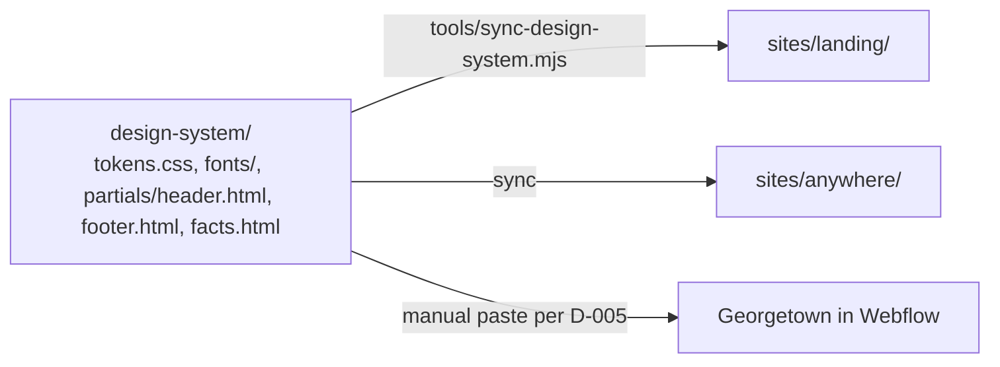

# 04 Design system specification

| Field | Value |
|---|---|
| Purpose | One token set, one component set, one motion vocabulary and one shell, consumed by the landing and both school sites so they read as one school. Values are extracted from the live sites by R1, never invented; this document fixes names, structure, rules and the file layout so extraction can land without redesign |
| Sources | `0_plan/07` Parts A and C, `0_plan/05` sections 3 and 6, `0_plan/04` (design system layer), the mirrored CSS and fonts |
| Decisions applied | DD-01, DD-02, DD-04, DD-08, DD-11, DD-19, DD-21, DD-26, DD-27, DD-36; MN-07, MN-09, MN-10, MN-11, MN-12, MN-13, MN-14, MN-15; D-003; CON-03; REQ-032, REQ-052, REQ-073 |
| Requirements covered | REQ-014, REQ-032, REQ-052, REQ-073, REQ-074 |
| Version | 0.1, 2026-09-10 |

## 1. Sources of truth for values

| Value | Extracted from | By | Rule |
|---|---|---|---|
| Typefaces | Both sites: Literata, Inter Tight and Inconsolata through the same Webflow Variables architecture (R1 section 2) | R1, done | Families fixed (DD-01, DD-19); roles assigned in section 2 |
| Colors | The Webflow Variables blocks of both sites, fetched without JavaScript | R1, done | Merged by value, not by name: the sites wire the same swatches to different roles (DD-19, R1 section 7) |
| Type scale, spacing, radii, shadows | Computed styles | R1 | Named tokens below |
| Motion durations and easings | CSS transitions on both sites (R1 found no inline GSAP calls, only the vendored library) | R1, done | Three durations (100, 200, 300 ms) and one easing (MN-13) |
| Breakpoints | Webflow boundaries in the mirrored CSS (991px desktop and tablet) plus the design breakpoints 390, 768, 1440 | R1 | |

## 2. Token schema

Tokens are CSS custom properties in `design-system/tokens.css`. Names are stable; values come from R1. Semantic roles, not raw colors, are used in components.

| Group | Token | Role | Value |
|---|---|---|---|
| Type | `--font-serif` | Display and body reading face | Literata (DD-01, DD-36) |
| Type | `--font-sans` | Labels, navigation, CTAs | Inter Tight |
| Type | `--font-mono` | Data labels, footnote markers | Inconsolata (inside the envelope) |
| Type | `--text-xs` to `--text-3xl` | Seven-step scale | R1 |
| Type | `--leading-tight`, `--leading-body` | Line heights | R1 |
| Color | `--color-bg`, `--color-surface`, `--color-surface-alt` | Page, cards, alternating sections | R1 |
| Color | `--color-text`, `--color-text-muted` | Body, secondary | R1 |
| Color | `--color-accent`, `--color-accent-contrast` | The single accent and its text color | R1 |
| Color | `--color-border`, `--color-focus` | Hairlines, focus ring | R1; focus meets 3:1 |
| Color | `--color-georgetown-tint`, `--color-anywhere-tint` | Secondary door cue only, never the sole cue (DD-04) | R1 |
| Space | `--space-1` to `--space-12` | 4px-based scale | R1 |
| Shape | `--radius-sm`, `--radius-md`, `--radius-lg` | | R1 |
| Elevation | `--shadow-1`, `--shadow-2` | | R1 |
| Layout | `--container-max`, `--container-narrow` | Content widths | R1 |
| Motion | `--duration-fast` 100 ms, `--duration-base` 200 ms, `--duration-slow` 300 ms | The only durations (MN-10, MN-13), the values both sites' CSS transitions already use (R1 section 6) | Evidenced by R1 |
| Motion | `--ease-standard` (`ease`) | The only easing; R1 found no second curve on either site | Evidenced by R1 |
| Z-index | `--z-header`, `--z-overlay` | | Fixed |

## 3. Components

| Component | Purpose | States | Accessibility | Motion | Decisions |
|---|---|---|---|---|---|
| Umbrella lockup | The parent identity; school name subordinate on school sites | Landing; school site; placeholder until Q-001 | Image alt "GT School" | None | DD-11, DD-27 |
| Header (landing) | Lockup, Current families, admissions contact | Default; mobile | `header`, `nav` | None | DD-12, DD-13 |
| Header (school site) | Lockup with school name, five menu items, Begin application CTA with `school=`, Current families, campus switcher | Default; open menu; scrolled | Keyboard-navigable menu; focus trap in the mobile list | Menu open 250 ms; none on scroll | REQ-031, REQ-032, MN-14 |
| Door card | One school choice: name, one line, cue set, CTA | Default; hover or focus styling (color and underline, no lift or expansion) | Whole card is one link with a full-name label; cue icon has alt text | None beyond hover and focus styling (MN-03 revised after R2); static dimensions | DD-04, DD-05, DD-26 |
| Door list | Renders N doors; two today, up to five | 2, 3, 4, 5 entries | List semantics | Same as door card | DD-21 |
| Campus switcher | Compact door list for headers | Default; open | Listbox semantics | Instant, with reserved space (MN-05 revised) | DD-21, MN-14 |
| Comparison table | Attributes by column, shared rows first | Default; sticky headers on mobile | Real `table` with `scope`; caption | None (MN-04 revised) | DD-06, DD-23 |
| Schedule visual | "A day at GT" per school | Default | Also rendered as a table for screen readers | None | DD-34 |
| Proof strip | One figure with footnote, accreditation mark | Default | Footnote as a link to the register source | None; static number, as the network's own sites present figures (MN-08 revised) | DD-07, DD-17 |
| TEFA module | Texas offer with window and expiry | Shown; hidden by expiry or region | Region-independent copy readable by all | None | MD-26, DD-28 |
| Decision helper | One question, two answers (Phase 2 experiment, DD-24 revised after R3) | Idle; answered; hidden without JavaScript | Buttons with full labels; result announced | Instant swap with reserved space | DD-24, MN-05 |
| CTA | Primary and secondary buttons and links | Default; hover with the text swap (MN-07, still a Differ row for Nari); focus; disabled never used | One accessible name (the swap duplicate is `aria-hidden`) | Swap 100 ms if kept | MN-07, REQ-074 |
| Accordion | FAQ | Closed; open | `button` with `aria-expanded`; jQuery-free | Reveal with clip and opacity, 200 ms; no height animation (MN-10) | REQ-036 |
| Facts block | Identical entity facts | Default | Definition list | None | SE-08 |
| Footer | Contact, sibling and umbrella links, legal, accreditation | Default | `footer`, `nav` | None | DD-17, MD-11 |

## 4. Fonts pipeline (T-009, T-065)

| Step | Rule |
|---|---|
| Source | The TTF files in the mirror for Literata and Inter Tight; Inconsolata from Google Fonts once, then self-hosted |
| Subset | Latin plus the characters the sites use (verified by scanning page text); woff2 |
| Load | Preload the display face used in the first screen; `font-display: swap`; fallback stacks tuned so the swap does not shift layout (MN-10, CLS 0) |
| Budget | Total fonts under 150 KB on the first screen |
| Where | `design-system/fonts/`, copied into each site by the sync step |

## 5. Shell and the copy step (D-003, REQ-052)

| Rule | Detail |
|---|---|
| One source | Tokens, fonts and partials live only in `design-system/`; sites contain copies produced by the sync step |
| Sync step | `tools/sync-design-system.mjs`, Node without dependencies, copies tokens and fonts into each site and replaces marker comments (`<!-- @partial header -->`) with partial contents; run before every preview build; idempotent |
| Georgetown | Header, footer and tokens pasted into Webflow site settings and symbols with Nari's go (D-005, D-021); the sync step emits a Webflow-ready bundle |
| Drift check | A verification (V-032) diffs each site's copies against `design-system/` |

## 6. Style envelope and departures (DD-19)

| Fixed | Free | Departure procedure |
|---|---|---|
| Type families; the merged palette | Layout, hierarchy, density, imagery, tone, motion within budgets | The mock's rationale row names the departure (for example M3's dark surface), the reason, and asks Nari to accept or reject it at G1 |

## 7. Imagery and assets (DD-08, DD-31)

| Rule | Detail |
|---|---|
| Sources | Existing photographs on either site, typographic treatments; no stock |
| Pipeline | Responsive sizes and formats generated by a small script (Phase 2); hero images sized and preloaded; everything else lazy |
| Alt text | Describes the cue, not the file |
| Consent | No child imagery without consent on file (AD-11) |

## 8. Tasks

| ID | Task | Phase | Owner model | Serves | Acceptance | Evidence | Ceiling |
|---|---|---|---|---|---|---|---|
| T-063 | R1 extraction: computed tokens from both live sites with third-party hosts blocked; motion settings from the GSAP configuration; a conflicts table | S1 | Builder, Sonnet 5 | DD-01, DD-02, MN-13, DEL-004 | Every token in section 2 has a value or a documented conflict | `0_plan/research/R1-design-tokens.md`; `design-system/tokens.css` draft | 60 min |
| T-064 | Token documentation and naming review; semantic roles confirmed | S3 | Fable | DD-19 | Names stable; every component in section 3 maps to tokens | `04` section 2 updated | 60 min |
| T-065 | Fonts integrated into the design system with preload plan and fallback tuning | S3 | Builder, Sonnet 5 | REQ-073, MN-10 | CLS 0 on font swap; budget met | Screenshots and Lighthouse | 60 min |
| T-066 | Partials: header (landing and school variants), footer, facts block | S3 | Builder, Sonnet 5 | REQ-032, SE-08 | Partials render in both site shells | Screenshots | 60 min |
| T-067 | Sync step `tools/sync-design-system.mjs` and the Webflow bundle emitter | S3 | Builder, Sonnet 5 | D-003, REQ-052 | Idempotent; diff clean after two runs | Command output | 60 min |
| T-068 | Component CSS: door card and list, switcher, comparison, schedule visual, proof strip, TEFA module, helper, CTA, accordion | S3 | Builder, Sonnet 5 | Section 3 | Each component renders in a styleguide page with every state | `design-system/index.html` | 60 min per group, 3 attempts |
| T-069 | Motion tokens and the reduced-motion layer | S3 | Builder, Sonnet 5 | MN-10, MN-11, MN-13 | Only the three evidenced durations and the one easing used; reduced-motion disables non-essential motion | Report | 60 min |
| T-070 | Side-by-side proof against both live sites (DEL-004 acceptance) | S3 | Fable; Astra verifies | DEL-004, CON-03 | Nari can see continuity; deviations listed as departures | `1_spec/runs/T-070.md` | 60 min |
| T-071 | Living styleguide page listing tokens, components and states | S3 | Builder, Sonnet 5 | REQ-032 | Every token and component appears | `design-system/index.html` | 60 min |
| T-072 | Accessibility check of every component: contrast, focus, names, keyboard | S3 | Watchdog, Haiku 4.5 runs axe; Fable reviews | REQ-074 | Zero violations | Report | 60 min |
