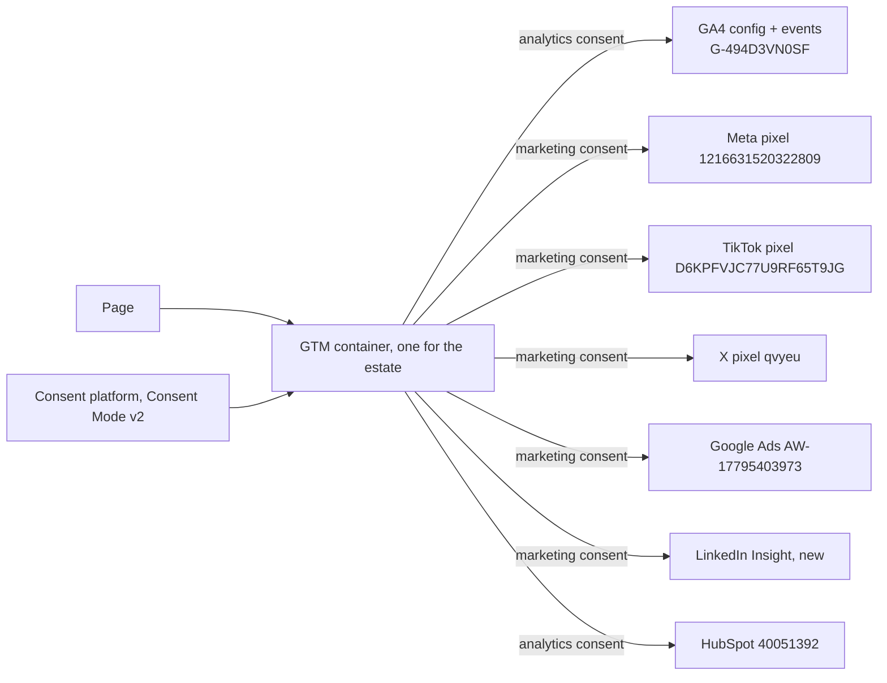

# 06 Analytics and tracking specification (the tracking plan, DEL-024)

| Field | Value |
|---|---|
| Purpose | Every tag, event, parameter, key event, consent category, stream and report the estate needs, so the landing's effect can be shown and the wrong-school metric computed. Implements `0_plan/07` Part D and the gaps in `0_plan/10` |
| Sources | `0_plan/10` (snapshot 2026-09-10), `docs/ANALYTICS.md` in the v1 checkout, `0_plan/07` Part D, `0_plan/08` section 3 (metrics) |
| Decisions applied | AN-01 to AN-18; D-010, D-014, D-015, D-026; MD-08, MD-09, MD-12, MD-14, MD-20; MO-1, MO-2, MO-4, MO-8, MO-9, MO-10 |
| Requirements covered | REQ-020, REQ-023, REQ-025, REQ-027, REQ-028, REQ-029, REQ-072 |
| Version | 0.1, 2026-09-10 |

## 1. Baseline and targets

| Metric (D-010) | Baseline, 28 days to 2026-09-10 | Target | Source |
|---|---|---|---|
| Wrong-school applications share | Unknown (Q-005); metric not yet computable | Below 2 percent | AN-07 |
| Door click-through | No landing yet | Above 60 percent of landing sessions | `door_click` / sessions |
| Application starts per school | `app_started` 152 across the estate; per school unknown | Up against baseline after two weeks | GA4 plus Supabase |
| Enrolled-family calls to the general line | Unknown (Q-005) | Down by half | Crystal, monthly |
| Traffic context | Anywhere 6,302 sessions; apply 686; organic social 2,493; organic search 1,834; direct 1,623; email 397; paid social 32; mobile 4,696 | | `0_plan/10` |
| Georgetown | No data; untagged | Measurable within 48 hours of T-008 | REQ-027 |

## 2. Container and consent (AN-03, AN-10, MD-20)

| Access and ownership (AN-02) | The property stays account-level on gtschool (Johnny administrator, Sana Malas marketer); Nari and Crystal added as viewers in T-103; access reviewed quarterly (D-025) |
|---|---|
| Server-side tagging (AN-12) | Deferred until spend and webview loss justify it; revisited with AD-06 |
| Product analytics (AN-13) | PostHog per D-014, after the measurement repair; masked replay and flags only under the consent posture |

| Element | Specification |
|---|---|
| Container | One GTM container for the landing, Anywhere v2 and Georgetown; the only hardcoded snippet on any page (AN-03); loaded after first paint on the landing (REQ-073) |
| Consent categories | `analytics` (GA4, HubSpot), `marketing` (pixels and ad tags). Google Consent Mode v2 is a compliance requirement for EEA and UK visitors, enforced since July 2025 (R3 S09, S32), not a discretionary choice; the posture for United States visitors (Texas law included) is counsel's decision (Q-016). Default until then: deny non-essential in regulated regions, notice elsewhere (AN-10). Basic and Advanced Consent Mode behave differently before consent (Advanced sends cookieless pings, Basic sends nothing); the chosen mode is recorded in AN-10 |
| Tag inventory | GA4 configuration and event tags; Meta base and custom events; TikTok base and events; X base and events; Google Ads conversion linker and conversions; LinkedIn Insight (after AD-04); HubSpot tracking (AN-17) |
| Workspaces | Container changes through workspaces with a description naming the decision id; published by Johnny after DebugView QA |
| Live deployment | Anywhere and Georgetown snippets require Nari's go (D-021); the landing ships with it |

## 3. Event schema (AN-04)

Naming is snake_case; parameters are standardized; every event names its destinations and consent category. Existing application events are unchanged and listed for completeness.

| Event | Surface | Trigger | Parameters | GA4 key event | Pixel custom events | Consent | Owner |
|---|---|---|---|---|---|---|---|
| `door_click` | Landing | Click on a door CTA | `school`, `placement` (first_screen, after_comparison), `variant` | No (audience signal) | Meta, TikTok, X, LinkedIn custom `DoorClick` with `school` | analytics; marketing for pixels | Johnny |
| `compare_view` | Landing | Comparison block 50 percent in view, once | `variant` | No | none | analytics | Johnny |
| `helper_answer` | Landing | Helper button | `route` (georgetown, anywhere) | No | none | analytics | Johnny |
| `cta_apply_click` | Landing, school sites | Begin application link | `school`, `placement` | No (the start is measured on apply) | none | analytics | Johnny |
| `cta_secondary_click` | Landing, school sites | Secondary CTA | `type` (faq, advisor, tour, info_session, intensives_calendar) | No | none | analytics | Johnny |
| `families_click` | Landing, school sites | Current families link | none | No | none; used to exclude from audiences (AD-07) | analytics | Johnny |
| `tefa_module_view` | Landing | Module in view | `region_source` (geo, default) | No | none | analytics | Johnny |
| `outbound_school_site` | Landing | Any link to a school host | `school` | No | none | analytics | Johnny |
| `faq_search`, `faq_helpful` | School sites | Search submit; helpful vote | `query_length` (no query text, AN-11), `helpful` | No | none | analytics | Johnny |
| `video_play` | School sites | Facade click | `video_id` | No | none | analytics | Johnny |
| `tour_booked`, `info_session_booked` | HubSpot | Meeting booked | `school` | Yes | Meta, TikTok, X, LinkedIn `Schedule` with dedup id | marketing | Nari |
| `generate_lead` | Anywhere interest form (today) | Successful submit | `event_id`, `transaction_id`, `lead_source`, value 10 | Yes (existing) | Meta `Lead`, TikTok lead, with the shared UUID | marketing | existing |
| `app_started`, `enroll_started`, `complete_enrollment`, `purchase`, `begin_checkout`, `form_start`, `enroll_form_*` | apply.gt.school | Existing | existing plus `school` once T-110 lands | `app_started`, `complete_enrollment`, `purchase` yes | Meta CAPI later (AD-06) | marketing | apply repo |

Custom dimensions (event scope): `school`, `placement`, `route`, `variant`, `type`, `region_source`; `lead_source` exists. User property: `variant` for the session's headline variant.

## 4. Key events (AN-05, REQ-028)

| Key event | Keep | Reason |
|---|---|---|
| `page_view` | Remove | Inflates conversions: 7,978 "key events" on Anywhere in 28 days |
| `generate_lead` | Keep | The interest form |
| `app_started` | Add | The application start, the primary landing conversion |
| `complete_enrollment` | Keep as key event | Enrollment |
| `purchase` | Keep | Tuition or deposit |
| `qualify_lead`, `close_convert_lead` | Keep only if anything fires them; otherwise remove | Unknown origin; audit in T-007 |
| `tour_booked`, `info_session_booked` | Add | Secondary conversions |

## 5. Cross-domain, parameters and streams (AN-01, AN-06, AN-15)

| Element | Specification |
|---|---|
| Property | One property (516065070), one web stream `G-494D3VN0SF` for every production hostname including gt.school and georgetown.gt.school |
| Linker | Domains: gt.school, georgetown.gt.school, anywhere.gt.school, apply.gt.school, community.gt.school; `decorate_forms` on |
| First-party parameters | Door and application links append `school=` and forward `utm_*` and `v=`; apply.gt.school reads `school` (T-110) |
| Development stream | A second web stream for localhost, 127.0.0.1, `*.vercel.app` previews, staging and `gt-anywhere.webflow.io`; the container selects the stream by hostname |
| Internal traffic | Filter for the team's IPs defined in GA4 |
| Hostname dimension | Reports split by hostname for per-site views |

## 6. Source of truth and the wrong-school metric (AN-07, REQ-072)

| Element | Specification |
|---|---|
| Truth for conversions | Supabase application and enrollment records; HubSpot for meetings |
| GA4's role | Funnel and attribution; sessions and behavior |
| Wrong-school metric | Applications where the `school` at application start differs from the school enrolled, or where the parent switches school during the process, divided by all applications; Crystal's manual log until the parameter exists |
| Reconciliation | Monthly: GA4 key events against Supabase counts; differences explained in `0_plan/10` |
| BigQuery | Daily export on; a scheduled query joins `app_started{school}` to enrollment outcomes for the metric (AN-14) |

## 7. Reporting (AN-14, D-014)

| Report | Content | Audience | Cadence |
|---|---|---|---|
| Looker Studio dashboard | The four KPIs (D-010), funnel by school, channel and campaign, hostname split | Nari, Johnny, Crystal | Weekly |
| Snapshot | `0_plan/tools/ga4-snapshot.py` output appended to `0_plan/10` | Everyone | Monthly and at every gate |
| Spend and results table | Channel, spend, sessions, key events, cost per application start | Nari, David | Weekly (AD-10) |
| PostHog | Funnels, masked session replay and flag experiments; adopted per D-014 after the measurement repair (Astra's condition) | Johnny | If adopted |

## 8. UTM governance (AN-08)

| Field | Allowed values or format |
|---|---|
| `utm_source` | meta, instagram, tiktok, x, linkedin, google, bing, hubspot, alpha, community |
| `utm_medium` | paid_social, cpc, social_organic, email, referral, bio |
| `utm_campaign` | `<school or umbrella>-<objective>-<yyyymm>`, for example `anywhere-tefa-202609` |
| `utm_content` | Creative id |
| `utm_term` | Search term for paid search only |
| `v` | Headline variant 1 to 3 (MD-03) |
| Builder | A shared sheet with validation; every link on a profile or ad is built there |

## 9. PII, retention and QA (AN-11, AN-18)

| Rule | Detail |
|---|---|
| No personal data | No names, emails or phone numbers in events or URLs; `faq_search` sends query length, not text; forms never send field values to GA4 |
| Identifiers in URLs | `fbclid`, `_hsenc` and similar are left to GA4's default handling and excluded from landing-page reports |
| Children | No data about a child is collected on any marketing surface |
| Retention | 14 months |
| QA per release | DebugView session recorded in the RUN-LOG; Tag Assistant pass; the launch checklist includes both |
| Change log | Every configuration change in `0_plan/10` section 5 |

## 10. Tasks

| ID | Task | Phase | Owner model | Serves | Acceptance | Evidence | Ceiling |
|---|---|---|---|---|---|---|---|
| T-100 | Tracking plan v1 published (this document marked v1) with owners per event | S0 | Fable | REQ-029, DEL-024 | Every event in section 3 has trigger, parameters, destinations, consent, owner | This file | 60 min |
| T-101 | Build the GTM container in a workspace: tags, triggers, variables for section 3; consent categories | S0 | Builder, Sonnet 5 prepares; Johnny applies | AN-03, MD-08 | Export matches the plan; DebugView shows events on the preview | Export JSON | 60 min |
| T-102 | Consent platform selection and Consent Mode v2 configuration per the decision from T-010 | S5 | Johnny | AN-10, MD-20, REQ-023 | Regional behavior verified | Screenshots per region | 60 min |
| T-103 | GA4 custom dimensions registered: school, placement, route, variant, type, region_source | S0 | Johnny | AN-04 | Dimensions visible in GA4 | Screenshot | 30 min |
| T-104 | Landing event QA in DebugView on the preview: every section 3 landing event fires with parameters | S5 | Builder, Sonnet 5 | REQ-020, REQ-025 | Capture per event | DebugView captures | 60 min |
| T-105 | Linker extension and `decorate_forms` on live Anywhere and apply, with Nari's go | S5 | Johnny with Nari | AN-06, MD-09 | Cross-domain session continuity verified | Test session report | 60 min |
| T-106 | Development stream and internal traffic filter; container stream selection by hostname | S0 | Johnny | AN-15 | Preview traffic lands in the development stream | Snapshot | 60 min |
| T-107 | BigQuery export and the wrong-school scheduled query | S0 export; S5 query | Johnny; builder writes the query | AN-07, AN-14, REQ-072 | Export active; query returns the metric | Query and result | 60 min |
| T-108 | Looker Studio dashboard with the four KPIs and funnel by school | S5 | Builder, Sonnet 5 prepares; Johnny connects | D-010 | Nari can read the four KPIs without a GA4 login | Dashboard link | 60 min |
| T-109 | UTM builder sheet with validation and the conventions in section 8 | S0 | Builder, Sonnet 5 | AN-08, AD-03 | Every allowed value enforced | Sheet link | 60 min |
| T-110 | Request in the application repo's Linear project: read `school`, show a confirm step, emit `school` on `app_started` | S0 request; S5 landing | Fable files; apply repo team builds | MD-09, MD-10, AN-07 | Issue accepted; parameter visible in GA4 | Linear id; DebugView | 30 min to file |
| T-111 | HubSpot tracking through the container behind analytics consent | S5 | Johnny | AN-17 | Email attribution intact | Report | 30 min |
| T-112 | PostHog evaluation per D-014 after the measurement repair: privacy configuration, masking, one funnel, one flag | S5 or later | Johnny | D-014 | Decision row updated with evidence | Report | 60 min |
| T-113 | Monthly snapshot automation (scheduled `ga4-snapshot.py`) appended to `0_plan/10` | S5 | Builder, Sonnet 5 | AN-18 | Runs monthly; output filed | Schedule and first output | 60 min |
| T-114 | PII audit checklist and a script that scans event payloads and URLs in DebugView exports | S5 | Builder, Sonnet 5 | AN-11 | Zero personal data found | Report | 60 min |
| T-115 | Tag map for every surface updated in `0_plan/10` section 2 after the container deploys | S5 | Fable | AN-09 | Every surface row current | `0_plan/10` | 30 min |
| T-116 | Reconciliation report template: GA4 key events against Supabase and HubSpot counts | S5 | Fable | AN-07, AD-10 | First monthly reconciliation filed | Report | 60 min |
| T-117 | Ad tags in the container: Meta, TikTok, X, Google Ads, LinkedIn, with custom events and dedup ids (see `08`) | S5 | Johnny; builder prepares | AN-09, AD-04, AD-05 | Each platform receives a test event | Platform test-event screenshots | 60 min |
| T-118 | Analytics section of the launch checklist (DEL-020): DebugView pass, consent behavior, stream selection, key events, dashboards | S6 | Fable | AN-18, DEL-020 | Signed | Checklist | 30 min |
