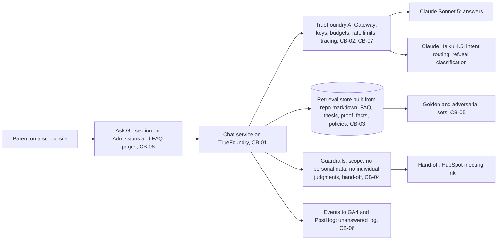

# 09 Chatbot platform specification (TrueFoundry readiness)

| Field | Value |
|---|---|
| Purpose | Everything that can be prepared now so the chatbot, once D-006's gate opens, is a content decision rather than an infrastructure project. Platform is TrueFoundry per D-017 |
| Decisions applied | CB-01 to CB-08; D-006, D-017, D-025; MD-20; REQ-036, REQ-037 |
| Deliverables | DEL-015 chatbot evaluation, DEL-023 readiness |
| Gate | Launch only after the FAQ page has 60 days of engagement data (D-006) and the CB-05 evaluation passes |
| Facts | Nothing TrueFoundry-related is installed or configured on the build machine today; the TrueFoundry offering and pricing must be confirmed first (CB-01) |
| Version | 0.1, 2026-09-10 |

## 1. Architecture

## 2. Components

| Component | Specification | Decision |
|---|---|---|
| Hosting | TrueFoundry-managed control plane and compute to start; self-hosting in GT's cloud only if data residency or cost demands it | CB-01 |
| Gateway | Every model call through the TrueFoundry AI Gateway; provider keys in the platform's secrets manager, never in the repo (D-025); budgets and rate limits per environment | CB-02, CB-07 |
| Models | Claude Sonnet 5 for answers; Claude Haiku 4.5 for intent routing and refusal classification; a fallback provider configured in the gateway | CB-02 |
| Knowledge base | Markdown sources under `sites/anywhere/content/` and `0_plan/` (FAQ, thesis, proof, facts, policies) chunked and embedded on every content change; answers carry citations to site URLs; no fine-tuning | CB-03 |
| Guardrails | Scope: the schools only; no collection of personal data from anyone, and nothing about a child; no individual admissions judgments; refusal templates; hand-off to a human through the HubSpot meeting link; claims only from the register | CB-04 |
| Evaluation | Golden set from the top-100 FAQ (Q-004); adversarial set (prompt injection, personal-data requests, admissions-judgment requests, off-topic); pass bar 95 percent correct and zero fabricated facts; Nari and Crystal sign off | CB-05 |
| Observability | Events `chat_open`, `question_asked{topic}`, `answer_rated{helpful}`, `handoff_click` to GA4 and PostHog; TrueFoundry tracing; weekly unanswered-questions log to the FAQ owner | CB-06 |
| Cost controls | Gateway budgets, rate limits, per-session token caps, response caching for common questions; David approves the ceiling | CB-07 |
| Placement | "Ask GT" section on Admissions and FAQ pages after the gate; not on the landing in v1 | CB-08 |
| Privacy | Children's-data rules from MD-20 apply; no conversation content stored beyond what the unanswered log needs; retention set with counsel | MD-20 |

## 3. Readiness checklist (DEL-023)

| Step | Before the gate | Owner | Status |
|---|---|---|---|
| Confirm the TrueFoundry offering, pricing and managed versus self-hosted options | Yes | Johnny | Not started |
| Create the workspace, SSO, billing owner | Yes | Johnny; David for billing | Not started |
| Configure the gateway: provider keys in secrets, budgets, rate limits, tracing | Yes | Johnny | Not started |
| Deploy a hello-world service through the pipeline | Yes | Johnny | Not started |
| Knowledge pipeline stub from repo markdown with citations | Yes, as soon as the FAQ exists | Builder, Sonnet 5 | Blocked on DEL-012 |
| Golden and adversarial evaluation sets | Yes | Johnny, Crystal | Blocked on Q-004 |
| Guardrail and children's-data policy text | Yes | Nari, counsel | Not started |
| Event schema entries in `06` section 3 | Yes | Fable | Done in this spec |
| Launch | After D-006's gate and CB-05 | Nari | Gated |

## 4. Tasks

| ID | Task | Phase | Owner model | Serves | Acceptance | Evidence | Ceiling |
|---|---|---|---|---|---|---|---|
| T-150 | Offering confirmation: TrueFoundry docs and pricing read; managed versus self-hosted decision drafted for CB-01 | S10 prep | Fable | CB-01, D-017 | CB-01 row updated with sourced facts | Register row | 60 min |
| T-151 | Workspace, SSO and billing owner set up | S10 prep | Johnny; David | CB-01 | Login works; billing owner named | Screenshot | 60 min |
| T-152 | Gateway configured with keys in secrets, budgets, rate limits, tracing | S10 prep | Johnny | CB-02, CB-07, D-025 | A test call through the gateway is traced and budgeted | Trace screenshot | 60 min |
| T-153 | Hello-world service deployed and reachable | S10 prep | Builder, Sonnet 5 | CB-01 | Health endpoint answers | curl output | 60 min |
| T-154 | Knowledge pipeline stub: markdown to chunks to store, citations preserved | S10 prep | Builder, Sonnet 5 | CB-03 | A query returns a chunk with its source URL | Test output | 60 min |
| T-155 | Golden and adversarial sets written and stored | S10 prep | Fable with Crystal | CB-05 | At least 100 golden and 30 adversarial items | Files | 60 min |
| T-156 | Guardrail policy and refusal templates approved | S10 prep | Nari, counsel | CB-04, MD-20 | Approved text | Document | 60 min |
| T-157 | Evaluation harness runs the sets against the gateway and reports the pass rate | S10 | Builder, Sonnet 5 | CB-05, DEL-015 | Report with per-item results | Report | 60 min |
| T-158 | Ask GT section wired after the gate: events, hand-off, caching | S10 | Builder, Sonnet 5 | CB-06, CB-07, CB-08, REQ-037 | Events fire; hand-off works; caps enforced | DebugView and gateway logs | 60 min |
