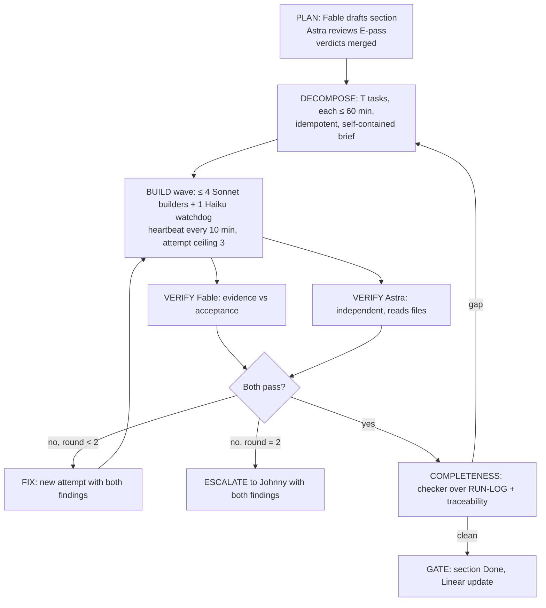
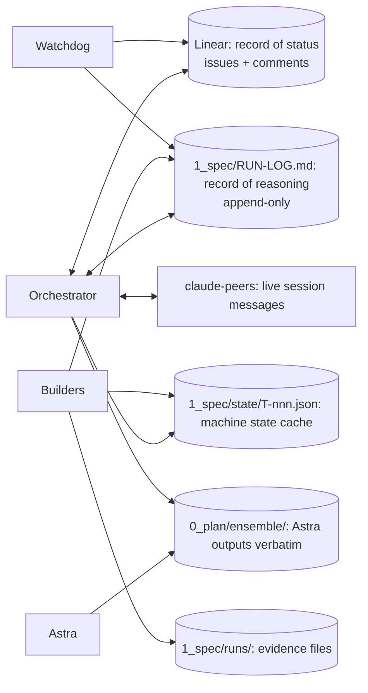

# 10 Build and operations spec: models, roles, the loop, communication, tracking, stall prevention, drift control

| Field | Value |
|---|---|
| Purpose | How the sites get built by a mixed team of models and people without anything being skipped, invented, or lost between agents. Every rule here is enforced by a template, a checker script, or a ceiling, not by good intentions |
| Binding decisions | D-012 (ensemble), D-018 (Linear owns status), D-019 (branches and PRs), D-020 (environments), D-022 (cadence), D-023 (definition of done), D-025 (secrets), D-026 (analytics authority); fan-out cap from the global working agreement (four builders plus one watchdog) |
| Version | 0.1, 2026-09-10 |

## 1. Roles and models

| Role | Model | May do | May not do | Where it writes |
|---|---|---|---|---|
| Orchestrator | Claude Fable 5.1 (the interactive session) | Decompose sections into tasks, dispatch waves, merge results, run checkers, write gate rows, escalate | Build more than one task itself while a wave runs; skip a checker; approve its own verification | `1_spec/RUN-LOG.md` gate rows; Linear project updates; `1_spec/state/` |
| Planner pair | Fable drafts; Codex Astra (`gpt-6-astra`, read-only) reviews | Author and review every spec section and every decision row | Astra may not edit the repo; Fable may not fill Astra's cell | `0_plan/07`, `1_spec/*`, `0_plan/ensemble/` |
| Builders | Claude Sonnet 5 subagents through the Agent tool (`model: sonnet`), one per task, isolated worktree | Implement exactly one `T-nnn` per dispatch; write its RUN-LOG rows; produce evidence | Change scope; touch files outside the task brief; invent ids or paths; wait on a human; mark Done | Branch `feat/gtt-<n>-<slug>`; `1_spec/runs/<T>.md`; RUN-LOG rows |
| Watchdog | Claude Haiku 4.5 subagent (`model: haiku`), one per wave | Poll heartbeats; run mechanical checks (`check-links`, `check-paths`, `check-runlog`, lint, screenshot capture); flag stalls | Fix code; judge design; mark anything Done | RUN-LOG heartbeat and stall rows |
| Verifier pair | Fable and Astra, independently | Verify each task's evidence against acceptance criteria; read the built files, not summaries; disagree | Verify a task it built (Fable never verifies a Fable-built task; that is why builders are Sonnet) | RUN-LOG V rows; `1_spec/runs/<V>.md` |
| Completeness checker | Astra, prompted with the checker rubric (section 9), plus `check-runlog.py` | Scan the run log and traceability matrix for gaps, thin reasoning, silent skips | Waive a gap | RUN-LOG checker rows |
| Fact auditor | Astra with read access, plus `check-claims.py`, `check-paths.py`, `check-links.py` | Confirm every cited fact, number, path and id exists where claimed | Accept a summary as evidence | RUN-LOG audit rows |
| Research agents | Claude Sonnet 5 subagents (R1 to R4) and Fable as synthesizer (R5) | Research with sources; write `0_plan/research/R*.md` | Decide; write to the register directly (R5 does that) | `0_plan/research/` |
| Humans | Johnny (gates G0, escalations), Nari (G0.5, G1, acceptance), David (spend, go-live), Crystal (facts), Holly (brand) | Decide at gates and escalations | Be waited on mid-wave; a mid-wave question becomes a Q row and the wave proceeds on the default | Linear comments; Slack; call summaries |

Model choice reasoning: Fable and Astra are the two strongest and most different models available, so planning and verification get diversity of error. Builders are Sonnet 5 because tasks are small, well-specified and parallel, and because a Fable-built task could not be verified by Fable without self-review. Haiku 4.5 does mechanical work where judgment is not needed. Per the environment guidance, Claude 5 models are the default for the Claude-side roles.

## 2. What every agent must know before touching anything

Every task brief links these, and a builder that cannot state them is refused the task at intake (section 4).

| Must know | Where |
|---|---|
| The five facts and the vocabulary | `0_plan/00-context.md` |
| The principles that bind decisions | `0_plan/08` section 3 |
| The hard rules (form, numbers, stock, exclusivity, N campuses, noindex) | `CLAUDE.md` |
| The decisions its task applies | The task brief's "Decisions applied" field, each an id in `0_plan/07` or `0_plan/03` |
| The acceptance criteria and evidence required | The task brief |
| The stop-and-ask list | `CLAUDE.md` |
| Which statements are human-attested truth and therefore frozen | `0_plan/TRUTH.md`; propose additions in `0_plan/truth-proposals.md`, never tag |

## 3. The loop, per spec section

| Step | Who | Output | Ceiling |
|---|---|---|---|
| Plan | Fable drafts the spec section; Astra reviews (E-pass); verdicts merged; first-screen disagreements escalate to Nari | Spec section at `Ready`; register rows `Agreed` | Two review rounds |
| Decompose | Fable writes T rows into the spec doc's Tasks table and Linear issues from the task brief template | Tasks in `Ready` | Every task ≤ 60 minutes of work; otherwise split |
| Build | Wave of at most four builders plus one watchdog; each builder one task on its own branch and worktree | Code, `1_spec/runs/<T>.md` evidence, RUN-LOG rows | 3 attempts per task; heartbeat every 10 minutes; 45 minutes silent means stalled |
| Verify | Fable and Astra each verify every task independently against its acceptance criteria, reading the built files and evidence | RUN-LOG V rows with Pass or Fail and findings | 2 rounds of fix and re-verify |
| Escalate | After the second failed round, or on any disagreement that changes the first screen | Linear issue in `Escalated` with both findings; RUN-LOG row | One escalation per task; Johnny decides |
| Completeness | `check-runlog.py`, `build-traceability.py`, then Astra with the section 9 rubric | Checker rows; gaps become new tasks | Runs before every gate; gate cannot open on a Fail |
| Gate | Orchestrator marks the section Done; Linear project update; next section | Gate row in RUN-LOG | |

## 4. Task design rules

| Rule | Why |
|---|---|
| One task, one outcome, at most 60 minutes of work | Small tasks stall less, verify faster, and re-run cheaply |
| Idempotent: re-running a task from scratch produces the same result | A stalled task can be re-dispatched without cleanup |
| Self-contained brief: everything needed is in the brief or linked by path; nothing lives in chat history | Any agent can pick it up |
| Acceptance criteria name ids (REQ, DD, MD, MN, AN, AD, CB, SE) and are observable in a browser or a file | "Looks good" is not verifiable |
| Evidence is specified up front: which screenshots, which command output, which file | Verifiers compare evidence to the spec, not to the builder's summary |
| A "next step" field is always filled, even when the next step is "verification" | The handoff note is never blank |
| Intake refusal: a builder that finds the brief ambiguous returns it with a Q row instead of guessing | Guessing is how drift enters |
| No new ids from builders: unknowns become a Q or a proposed row for the planner, never an invented REQ, path or number | Single source of ids |

## 5. Communication protocol

Tools deliberately not used for agent communication (D-024): Notion, Google Docs, email threads. Requirements stay in git as the source of truth (D-013), with the Google Sheet as a generated view; the planning folder is `0_plan/` and the spec `1_spec/` (D-008).

| Channel | Carries | Written by | Read by | Rule |
|---|---|---|---|---|
| Linear issue (one per T and per V) | Status, task brief (description), heartbeats, handoffs, verification reports, escalations (comments) | Orchestrator creates; builders, watchdog and verifiers comment through the orchestrator or directly when they have access | Everyone | The status field is the truth (D-018) |
| `1_spec/RUN-LOG.md` | Every step's reasoning and evidence path, append-only | Whoever did the step | Checkers, verifiers, the next agent | A row without reasoning is invalid (`check-runlog.py`) |
| `1_spec/runs/<id>.md` | Evidence: screenshots (paths), command output, diffs, harness results | Builders and verifiers | Verifiers, auditors | Evidence is files, not prose |
| `1_spec/state/<T>.json` | `{id, status, attempt, last_step, next_step, owner, branch, updated, linear}` | Builders on every heartbeat; orchestrator on transitions | The next agent | Cache only; Linear wins on conflict |
| `0_plan/ensemble/` | Astra's outputs verbatim | Orchestrator captures | Everyone | Never edited |
| claude-peers | Live coordination between running Claude sessions | Sessions | Sessions | Nothing decided here is real until it is in Linear or the RUN-LOG |
| Slack | Humans | Humans | Humans | Decisions are copied into planning within a day |

Templates live in `1_spec/templates/` and are the only accepted formats. A comment or row that does not follow its template is returned by the watchdog.

| Template | File | Required fields |
|---|---|---|
| Task brief | `task-brief.md` | Id, title, phase, owner model, REQ ids, decisions applied, inputs (paths), steps, acceptance criteria, evidence required, out of scope, next step, ceiling |
| Heartbeat | `heartbeat.md` | Id, attempt, elapsed, last completed step, current step, blockers, next step, evidence so far |
| Handoff | `handoff.md` | Id, attempt, why stopping, state of the work (branch, files touched), what is verified, what is not, exact next step, traps for the next agent |
| Verification report | `verification-report.md` | V id, T id, verifier (Fable or Astra), acceptance criteria checked one by one, evidence read, verdict, findings with severity, re-verification needed |
| Blocker or escalation | `blocker.md` | Id, attempt, what blocks, what was tried, alternative considered, decision requested, owner, escalation id |
| Decision request | `decision-request.md` | Proposed id, question, options, Fable recommendation, Astra recommendation, what waits on it |
| Completeness report | `completeness-report.md` | Section, rows checked, gaps found (each with id), thin-reasoning rows, silent-skip rows, verdict |

## 6. Linear project design

Created only after this spec is approved, because states and templates are hard to change once issues exist (push-back, section 12).

| Element | Specification |
|---|---|
| Project | "GT Web Redo" in team GT School (GTT); Q-026 confirms the team and the `gta-NNN` mapping |
| Issue kinds | Task (`T-nnn: <verb> <object>`), Verification (`V-nnn: verify T-nnn (<Fable or Astra>)`), Decision (`D-nnn` or register id), Blocker, Gate |
| Workflow states | Backlog, Ready, In Progress, In Verification, Blocked, Escalated, Done, Cancelled (Cancelled requires a Blocker template with alternative and owner) |
| Labels | Phase `S0` to `S10`; model `fable`, `astra`, `sonnet`, `haiku`; kind `build`, `verify`, `research`, `decision`; surface `landing`, `anywhere`, `georgetown`, `analytics`, `seo`, `ads`, `chatbot` |
| Parent issues | One per spec section; tasks and verifications are children |
| Description | The task brief template, verbatim |
| Comments | Heartbeats, handoffs, verification reports, escalations, each in its template |
| Relations | `blocks` and `blocked by` for dependencies; verification issues `related to` their task |
| Project updates | Weekly, generated from RUN-LOG gate rows (D-022) |
| Naming | Branch `feat/gtt-<number>-<slug>` so Linear links the PR automatically |

## 7. Stall prevention and recovery

| Stall type | Detection | Response |
|---|---|---|
| Agent silent | No heartbeat for 15 minutes: watchdog pings; 45 minutes: task marked Stalled | Watchdog writes a handoff note from the last heartbeat; orchestrator re-dispatches with attempt plus one to a fresh builder |
| Same error repeating | Three identical failures in heartbeats | Builder must stop and file a Blocker with what was tried and an alternative |
| Waiting on a human mid-wave | Any heartbeat whose blocker names a person | Forbidden. Convert to a Q or decision-request row, proceed on the documented default, note the assumption in the RUN-LOG |
| Scope creep | Files touched outside the brief (watchdog diff check) | Return the task; the extra work becomes a proposed T for the planner |
| Context loss between agents | A new agent cannot state the task's next step | The brief is self-contained by rule; if it is not, the planner failed and fixes the brief first |
| Ambiguous acceptance | Builder or verifier cannot map a criterion to an observable | Intake refusal; planner rewrites the criterion |
| Tool or environment failure | Command fails for reasons unrelated to the task | Blocker with the exact error; orchestrator fixes the environment; task re-dispatched |
| Runaway cost | Attempt exceeds 60 minutes or the section exceeds its budget | Ceiling: stop, write handoff, escalate |

Recovery procedure for any agent picking up a task: read the task brief, the last heartbeat, the handoff note and the task's RUN-LOG rows; confirm the state file matches Linear; continue from `next_step`. Never restart from scratch unless the handoff says the work is unusable, and say why in the RUN-LOG.

## 8. Hallucination and drift controls

| Control | Catches | Tool or agent | When |
|---|---|---|---|
| Id integrity | Ids referenced but never defined; ids defined twice | `0_plan/tools/check-links.py` | Every commit; every gate |
| Register completeness | A decision row missing either model's cell, a verdict, or either model's verification; unsupported numbers, unknown ids or missing paths inside a cell | `0_plan/tools/check-register.py` and the loop in `0_plan/12-register-loop.md` | Every gate; no build task starts on a decision whose row is not Complete or Escalated |
| Path integrity | Invented file paths in any document | `1_spec/tools/check-paths.py` against `1_spec/tools/planned-paths.txt` | Every commit; every gate |
| Claims integrity | A number on a built page with no claims-register row | `1_spec/tools/check-claims.py` (T-005) | Every build verification |
| Truth drift | An attested statement changed anywhere, a `[SoT]` tag with no attested row, or the manifest edited outside a human commit (signed human commits and code-owner review per D-027) | `0_plan/tools/truth.py check` | Every commit; every gate |
| Coverage | A planning id no spec section addresses; a REQ with no task or no verification | `1_spec/tools/check-coverage.py`, `1_spec/tools/build-traceability.py` | Before every phase starts and at every gate |
| Run-log completeness | Rows without reasoning, silent skips, Done without both verifications | `1_spec/tools/check-runlog.py` | Every commit; every gate |
| Fact audit | A cited fact that is not in the file it is attributed to | Astra pass reading the actual files; Fable cross-checks Astra's own citations | Every E-pass; every gate |
| Evidence over summary | A verifier judging a builder's description instead of the artifact | Verifier rule: open the files and screenshots; quote them in the report | Every V row |
| Spec drift | Built page differs from the spec section | Verifier compares the artifact to the spec section by section | Every V row |
| Planning drift | Spec or build proceeds on a decision the planning docs do not hold | Coverage check plus the rule that `0_plan/` changes first | Every gate |
| Model diversity | Same-model blind spots | Fable and Astra both verify; builders are a third model | By design |

## 9. The run log and its checker

`1_spec/RUN-LOG.md` is append-only and machine-checked. Columns and rules:

| Column | Rule |
|---|---|
| # | Sequential |
| Timestamp | ISO date and time, local |
| Item | The id the row is about: T, V, REQ, D, register id, or `GATE-Sn` |
| Step | One of: Intake, Plan, Build, Heartbeat, Handoff, Verify-Fable, Verify-Astra, Fix, Audit, Completeness, Gate, Escalate, Blocker |
| Agent | Role and model, for example `Builder, Sonnet 5` or `Verifier, Astra gpt-6-astra` |
| Action | What was done, one sentence |
| Reasoning | Why, and what was considered; at least 20 words; must not be "n/a", "skipped", "cannot be done" or "as requested" |
| Evidence | A path under `1_spec/runs/`, `0_plan/ensemble/` or the repo, or a command; required for Build, Verify, Audit and Gate rows |
| Status | One of: Started, In progress, Done, Failed, Blocked, Stalled, Escalated, Pass, Fail, Skipped |
| Checker | Pending, Pass, or Fail with a reason; written only by the completeness checker |

Skip rule: a row with status Skipped, Blocked or Failed must carry in its Reasoning the tokens `why:`, `alternative:`, `owner:` and an escalation id (a Q, D, T or Linear id). A row without them fails the checker, and a checker Fail closes the gate.

Done rule: a T may be marked Done only after a `Verify-Fable` Pass row and a `Verify-Astra` Pass row exist for it. `check-runlog.py` rejects any Done row without both.

## 10. Ceilings

| Ceiling | Value | On breach |
|---|---|---|
| Builders per wave | 4, plus 1 watchdog | Queue the rest |
| Task size | 60 minutes of work | Split at intake |
| Build attempts per task | 3 | Escalate with all three handoffs |
| Verification rounds per task | 2 | Escalate with both verifiers' findings |
| Escalations per task | 1 | Johnny decides; decision logged as a D row |
| Heartbeat interval | 10 minutes of work | Watchdog pings at 15, stalls at 45 |
| Ensemble passes per section | 3 (plan review, verification, completeness) | Report at the ceiling; do not loop further |
| Section wall-clock budget | Set at decompose time in the section's Tasks table | Stop, handoff, escalate |
| Research re-runs | 1 per agent | Accept with gaps flagged |

## 11. Definition of done

| Level | Done means |
|---|---|
| Task | Acceptance criteria met; evidence filed; `Verify-Fable` Pass and `Verify-Astra` Pass; RUN-LOG rows complete; Linear Done; branch merged or evidence that merge waits on the section |
| Section | Every task Done; completeness checker Pass; traceability matrix shows every REQ in the section with tasks and both verifications; Astra fact audit Pass |
| Phase | Exit criteria in `00` section 2 met; gate row in RUN-LOG; Linear project update posted |
| Requirement | Referenced by a Done task and two Pass verifications; status `Done` in `0_plan/02` |

## 12. Push-back and recommendations

| Request | Concern | Recommendation |
|---|---|---|
| "Every requirement verified by both Astra and Fable" | 48 requirements, several tasks each, two verifiers, up to two rounds: hundreds of verification rows | Verification is per task, not per requirement; each task's V rows list the REQ ids they cover, so every REQ is still verified twice. The traceability matrix proves it |
| "Faster models to build using swarms" | The global working agreement caps fan-out at four plus one; more builders means more merge conflicts on eight duplicated HTML files | Waves of four; tasks partitioned by file so no two builders touch the same page |
| "A new Linear project" | States and templates are hard to change once issues exist | Approve section 6 first, then create the project; issues for S0 first |
| "Prevent agent stalling" | Stalls are usually caused by ambiguous briefs and mid-task human questions, not by slow models | The intake refusal rule and the no-waiting-on-humans rule remove the two main causes; heartbeats and the watchdog catch the rest |
| "Everything to full detail" | Several facts are unknown (tuition for Georgetown, the correct speed claim, the community hub, DNS control) | The spec marks each as `TBD (Q-nnn)` and never fills the gap with a guess; detail cannot outrun facts |
| "Hallucination and drift checks" | Prose promises do not catch hallucinations | Five scripts and two audit passes, all listed in section 8, run at every gate; a gate cannot open on a Fail |
| Astra as completeness checker and verifier | Astra has no memory across runs and the skills context costs 7k tokens per run | Batch the checker per section, not per row; give it the rubric and the files, not summaries |
| Sonnet builders for design-heavy mocks | Design taste varies more across models than code quality does | Builders work from the design-system tokens and the per-mock spec in `03`; Fable reviews design before Astra verifies; G1 is Nari's |
